# A SCIM 2.0 Library for walt.id — Design v2

**Version 2.2 — revised after the walt.id review (October 2026) and two architecture review rounds (November 2026)**  
Author: Saurabh Kushwaha

---

## Executive summary

*A two-minute read. Sections 1–15 hold the technical detail for reviewers and implementers.*

**What it is.** An open-source SCIM 2.0 library that lets enterprise directories such as Microsoft Entra ID and Okta create, update, deactivate and delete accounts and groups in walt.id products automatically.

**Why it matters.** Enterprise customers run walt.id alongside an IAM system they already own. With SCIM, a joiner added in Entra appears in walt.id, and a leaver disabled there is disabled here in the next provisioning cycle. The walt.id product can then end sessions, disable API keys and, later, suspend credentials it issued to that person.

**How we are working together.** walt.id reviews the work, builds the Ktor web routes, integrates it with the Enterprise Stack and co-maintains the library with me. I build the protocol core and the first adapter on the Wallet2 API.

<p align="center">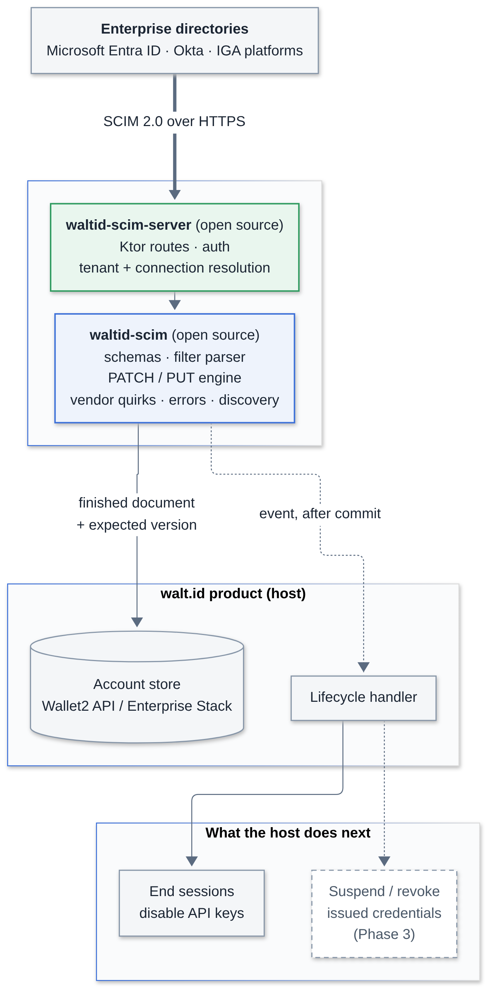</p>

*Figure 1. Where the library sits: directories call it over SCIM, it hands finished data to the product, and the product reacts to lifecycle events*

**What changed after review**

| Decision | Why |
|---|---|
| The library does the SCIM work (PATCH, PUT, `meta`, errors, discovery). Products only store data. | The hardest, most error-prone part of SCIM is built and tested once, not in every service. |
| Tested handling of real Entra and Okta behaviour is built in. | Both clients bend the standard. The library's value depends on working with them out of the box. |
| Every call carries tenant, connection, caller and request id. | A multi-tenant product such as the Enterprise Stack cannot be built without it. |
| The library raises an event after every committed lifecycle change. | Products end sessions, disable keys and, later, revoke credentials without knowing SCIM. |
| Credential binding is x509-first, per issued credential, in a separate optional module. | Matches eIDAS 2.0, ISO mdoc and HAIP, and keeps unlinkable credentials unlinkable. |
| Each connection sees and changes only the accounts in its own provisioning scope (tenant plus domain). Anything outside it is a 404. | Two directories feeding one product must never read or modify each other's users. |
| A deactivation blocks new sign-ins the moment it is saved, and session revocation is recorded durably so it finishes even if the client never retries. | "Disabled in Entra" has to mean "cannot get in here", not "will be cleaned up later". |
| Accounts are never linked by a matching email or name. `id`, `externalId` and `userName` have separate, written rules. | Prevents duplicate accounts and silent takeover when users come from two directories. |
| Discovery advertises only what the backing store can actually do. | A store without Groups or ETags must not claim them, or Entra and Okta tests fail. |
| Phase 1 ships as four reviewable PRs, and a real adapter must pass before the design counts as proven. | Smaller reviews, and an in-memory store alone does not prove the abstraction works. |

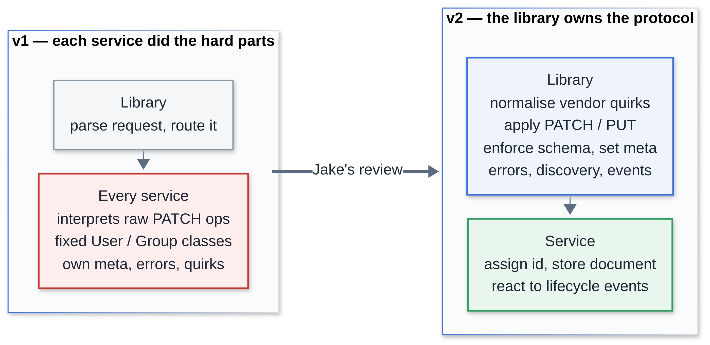
*Figure 2. v1 left the hard parts to every service; v2 moves them into the library*

**Plan**

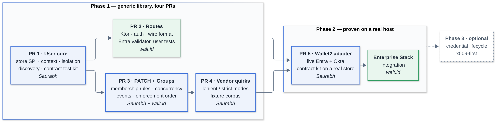
*Figure 3. Delivery phases and owners*

**What I need from walt.id** (full list in §15)

1. Sanitized SCIM traffic from Enterprise customers, so the tests use real Entra and Okta payloads.
2. Confirmation that the Wallet2 API is the right first host, and what a SCIM User should map to there.
3. How the Enterprise Stack identifies tenants today, whether two connections in one tenant should see each other's accounts, and whether it has an event bus the library's events should feed.

**Main risks**

- Entra still sends two different PATCH formats, depending on a per-app flag. The library accepts both, and each format has its own tests.
- Entra and Okta don't use version checks and Entra sends requests in parallel. The library detects conflicting writes itself and retries them, so updates are not lost.
- Safe concurrent writes need an atomic conditional write in the store. Without one, the library only runs in development or in an explicitly single-writer deployment.
- Isolation between connections depends on each store adapter scoping its queries correctly. The library checks the domain of everything a store returns and ships a contract test kit, but it cannot see the host's data.
- Signing status lists with x509 certificate chains, which HAIP requires, may not exist in walt.id yet. That only affects Phase 3.

*Colour key for all diagrams: blue = SCIM library core, green = built or owned by walt.id, grey = existing systems and data, dashed = optional or later, red = rejected input or the old approach.*

---

## 1. What changed since v1

Jake's review (walt.id COO) raised seven points about the SCIM library and three about the DID/VC binding. walt.id has also agreed to review the contribution, handle Enterprise Stack integration, co-maintain the library, and build the Ktor web routes module. I accepted both offers. Jake also noted that the OSS services have no SCIM-style integration today, but the Wallet2 API can host initial development.

The biggest change is the direction of responsibility. In v1 the library handed work down to the host. In v2 the library does the protocol work and the host persists documents.

| # | Jake's point | Decision in v2 | Where |
|---|---|---|---|
| 1 | Library applies partial updates; large-group membership optional | The library loads, applies all ops atomically, checks mutability, and hands the finished document to the store with the expected version. An optional membership-delta store handles big groups. | §4.1–4.4, §6 |
| 2 | Every call needs context | `ScimRequestContext` carries tenant, connection, principal, request id, base URI and preconditions. It is passed to every SPI call and event. | §5, §6 |
| 3 | Schema-described documents, not fixed classes | `ScimDocument` is a case-insensitive JSON tree. A schema registry drives validation, mutability, `returned` and discovery. Typed views sit on top. Enterprise User is just another registered schema. | §3 |
| 4 | Split on day one; protocol module free of server libs | `waltid-libraries/protocols/waltid-scim` (Kotlin Multiplatform, no Ktor server) and `waltid-scim-server` (JVM, Ktor). walt.id builds the routes. | §8 |
| 5 | Library does bookkeeping; PUT clears omitted fields; 1-based paging; library-defined page size | The library owns `meta`, discovery, the error body and `scimType` mapping, PUT semantics, and paging defaults. | §4.3, §7 |
| 6 | Vendor quirks built into the parser and tested | A compatibility layer with a lenient default, an RFC mode and an opt-in interop-profile mode. Every rule has a fixture. | §9 |
| 7 | Small lifecycle callback; library knows nothing of sessions/credentials | Events fire after commit only, with an optional in-transaction hook for an outbox. Naming follows RFC 9967. | §10 |
| B1 | x509 over DIDs in phase one | Credential lifecycle binding is x509-first: trusted lists, IACA/DS, `x5c`, HAIP. DIDs are optional later. | §11.1 |
| B2 | Per-credential and batch keys make user-to-DID binding awkward | Bind the account to issued credential instances, never to holder keys or DIDs. | §11.2 |
| B3 | No per-claim revocation in Token Status List / Bitstring Status List | Status is per credential. A claim change means revoke and reissue. Partial revocation is dropped. | §11.3 |

What stayed the same: the SCIM-versus-OIDC-Bridge framing, use cases UC1–UC3, the real RFC 7644 filter parser, index pagination in Phase 1, no `/Me` or `/Bulk`, and Entra and Okta as the first interoperability targets.

### 1.1 Architecture review (November 2026)

A second reviewer supported moving to prototyping and named the boundary between the generic protocol code and the host's provider as the main risk. The review was done against the v1 file, so some points were already handled in v2.0. The table shows what was already there and what v2.1 adds.

| Review point | Priority | Already in v2.0 | Added in v2.1 | Where |
|---|---|---|---|---|
| Provisioning authorization and tenant/connection isolation | P0 | Request context with tenant, connection and principal; per-connection credentials; 401 for a wrong connection | Per-operation permissions, a provisioning domain that scopes every store call, out-of-domain ids return 404, a domain check on store results, cross-connection tests | §5.1, §5.3, §6, §13 |
| PATCH semantics belong in the library; atomic, version-aware persistence | P0 | The library applies PATCH on a copy and writes with compare-and-set; retries on conflict | Rollback test (a failure at op *n* leaves the store and events untouched); conditional DELETE called out on the wire | §4, §12, §13 |
| Deactivation must deny access | P0 | Deactivation separate from deletion; post-commit event | Written access-control guarantee; a fail-closed enforcement step that runs before commit for hosts that need immediate revocation | §2.2, §10.4 |
| Identity correlation and uniqueness | P1 | `id` host-assigned, `externalId` client-owned, 409 on uniqueness | Rules for all three identifiers, uniqueness domain equal to visibility domain, no linking by email, connection replacement, test scenarios | §3.5, §13 |
| Group membership consistency | P1 | Membership deltas, effective add/remove, no-op re-adds | Rules for unknown members, duplicates, user delete, nested groups, the read-only `groups` attribute and partial failure | §4.6 |
| Capability discovery must match the provider | P1 | SPC built from the registry and store flags | A capability profile that drives route registration, SPC, `/ResourceTypes` and `/Schemas`, and separates what the parser accepts from what the store can query | §7.5 |
| Wire-level requirements | P1 | Status codes, ETag, Location in places | One table for content types, the ListResponse envelope, headers, projection and status codes | §7.6 |
| Phase 1 too large; a real adapter is needed | P1 | Phase 2 adapter on the Wallet2 API | Phase 1 split into four PRs with acceptance criteria; the design counts as validated only after PR 5 passes on the real adapter | §14 |
| Operational protections | — | Max page size, 429 | Limits on filter length, depth and terms, body size and PATCH ops; searchable attributes declared by the store; audit records | §7.7 |

The reviewer also recommended keeping the full filter parser while starting from the queries Entra actually sends (`eq` and `and` on `userName`, `externalId` and Group `displayName`). §7.5 does exactly that.

### 1.2 Architecture review, second round (November 2026)

The second round reviewed v2.1 and kept three decisions explicitly: schema-described documents, atomic PATCH in the core, and an explicit provisioning domain. It raised nine findings and six smaller corrections. I accepted all but one in full. The ETag finding I accepted in part, because SCIM itself specifies weak ETags with `If-Match`, and §4.5 now explains that exception instead of hiding it.

| # | Finding | Priority | Decision in v2.2 | Where |
|---|---|---|---|---|
| 1 | Strict mode rejected RFC-valid path-less PATCH | P0 | **Accepted.** Three modes: lenient (default), RFC (accepts everything RFC 7644 allows, including path-less PATCH) and an opt-in interop-profile mode that applies the narrower draft rules | §9.1, §9.2 |
| 2 | Weak ETags with `If-Match` conflict with HTTP strong comparison | P0 | **Partly accepted.** ETags stay weak, because SCIM responses vary with `attributes` projection and RFC 7644 §3.14 itself sends `If-Match: W/"…"`. The weak `If-Match` comparison is now documented as a SCIM-specific exception, and the store's compare-and-set token is separate from the HTTP ETag | §4.5, §7.6 |
| 3 | In-process lock is unsafe across nodes; membership deltas do not all commute | P0 | **Accepted.** Writable stores must provide atomic conditional writes. The lock is allowed only for development or a deployment declared single-writer, and the server refuses to start otherwise. The commute claim is corrected | §4.4, §4.5, §6 |
| 4 | Unknown attributes need a trust boundary; case-insensitive duplicate keys | P1 | **Accepted.** An explicit unknown-attribute policy, opaque data kept apart from registered attributes and never usable as entitlements, and conflicting duplicate keys rejected | §3.2 |
| 5 | Opaque versions cannot order events | P1 | **Accepted.** Stores return a monotonically increasing `revision` per resource; events are ordered by it, and `version` stays the ETag | §6, §10 |
| 6 | Deactivation guarantee needs qualification; recovery must not depend on client retries | P1 | **Accepted.** The revoke-then-commit ordering is replaced by a durable revocation intent written in the same transaction as `active=false`, plus a reconciler. Each host states its existing-access guarantee, and the response never claims more | §10.4 |
| 7 | `provisioningDomain` defaulting to `connectionId` can collide across tenants | P0 | **Accepted.** `ProvisioningScope(tenantId, domainId)` replaces the bare string, and every store call, uniqueness rule and membership lookup uses the full scope | §5.1, §5.3, §6 |
| 8 | Large Group reads still materialise every member | P1 | **Accepted.** Members are returned in full or not at all, up to a configured limit; above it the request fails with a clear error. Member reads must come from one consistent snapshot, and membership checks use a filter instead of the list | §4.7, §6 |
| 9 | Credential status mapping must be policy-driven, especially reactivation | P1 | **Accepted.** An issuer-owned policy decides each transition. Reactivation clears only suspensions the SCIM deactivation itself caused | §11.3 |
| — | Smaller corrections: "idempotent" wording, PUT retries, empty strings, outbox recommendation, PR 2 validator timing, references | — | **Accepted**, with one note: the Token Status List draft is in the RFC Editor queue (IESG-approved, revision -21), not still with the IESG. v2.1 already called it a draft, not an RFC | §3.5, §4.5, §9.2, §10.2, §14, References |

---

## 2. Framing and use cases

### 2.1 SCIM and the OIDC Bridge stay separate

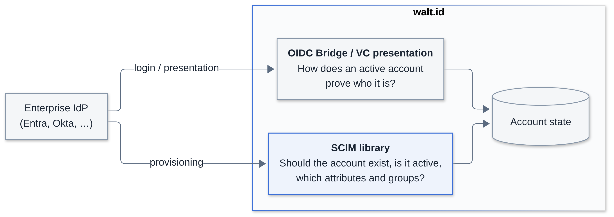
*Figure 4. SCIM and the OIDC Bridge answer different questions and meet only at account state*

The two solve different problems. The OIDC Bridge, and authentication generally (OIDC, VC presentation, passkeys), answers *how does an active account prove who it is?* SCIM answers *should this account exist, is it active, and which directory-managed attributes and group memberships should it have?*

| | OIDC Bridge | SCIM library |
|---|---|---|
| Primary concern | Authentication | Provisioning and lifecycle |
| Trigger | Login / presentation | Directory lifecycle operation |
| Source | Authentication flow | Enterprise IdP / IGA |
| Shared dependency | Account state, if the host chooses | Account state, through the store SPI |

Neither depends on the other. A SCIM deactivation may end sessions, but that decision belongs to the host and reaches it through the lifecycle callback (§10). It is not SCIM protocol behaviour.

### 2.2 Use cases

**UC1 — Provision and deprovision accounts from an enterprise IdP.** This is the main reason for the library. Entra ID, Okta or an IGA platform calls a walt.id-hosted SCIM endpoint. The library validates the request, applies it, and persists through the host store. Two behaviours shape the design. First, deactivation (`active=false`) is not deletion: a deactivated user stays addressable and can be reactivated. But it is an access-control change: once the library reports success, the account cannot start new authenticated access in the host, and what happens to existing sessions is host policy that must be written down (§10.4). Second, real clients bend the RFC, and the library absorbs that in an explicit, tested layer rather than in route handlers.

**UC2 — Groups and membership.** The library supports standard Group resources and incremental membership changes. What a group *means* inside a product (a role, an entitlement, a wallet policy) is the host's business. The library owns the protocol behaviour and the host owns the mapping.

**UC3 — walt.id services adopt SCIM independently.** Wallet, Issuer, Verifier and Enterprise deployments do not share one account model. A service adopts SCIM by implementing the store SPI for the resource types it needs. A service that does not need SCIM takes no dependency on it.

### 2.3 First host: the Wallet2 API

The walt.id team pointed to the Wallet2 API as the place to develop against, since the OSS services lack this integration and the Enterprise Stack integration is theirs to do. The Wallet2 server library already has account hooks: an account resolver on its routes and `linkWalletToAccount` / `getWalletIdsForAccount` on its store. That makes it a natural place to attach a SCIM User. This is my reading of the code and still needs walt.id to confirm. The Phase 2 adapter (§14) is a store implementation over that account model. Nothing in the protocol module depends on it.

---

## 3. Resource model: schema-described documents

### 3.1 Why fixed classes fight the protocol

RFC 7643 makes attribute names, sub-attribute names and schema URNs case-insensitive ([RFC 7643 §2.1](https://www.rfc-editor.org/rfc/rfc7643#section-2.1); [RFC 7644 §3.10](https://www.rfc-editor.org/rfc/rfc7644#section-3.10)). Extension attributes live under a JSON object keyed by the extension URN, and paths address them as `urn:…:User:attr.sub` ([RFC 7643 §3.3](https://www.rfc-editor.org/rfc/rfc7643#section-3.3)). A PATCH that adds an attribute by its fully qualified URN implicitly adds that URN to `schemas` ([RFC 7644 §3.5.2](https://www.rfc-editor.org/rfc/rfc7644#section-3.5.2)). Filter comparison and uniqueness both depend on each attribute's `caseExact` ([RFC 7643 §7](https://www.rfc-editor.org/rfc/rfc7643#section-7)). Clients also send things the library has no class for: Entra adds a Microsoft ADSCIM group schema URN to Group creates ([Entra SCIM tutorial](https://learn.microsoft.com/en-us/entra/identity/app-provisioning/use-scim-to-provision-users-and-groups)), and customers add their own extensions.

A `data class ScimUser` breaks on every one of these. The mature libraries have mostly converged on the same answer. UnboundID/Ping `scim2` keeps a `GenericScimResource` over a case-insensitive `ObjectNode`, with `UserResource` and friends as typed views ([GenericScimResource](https://github.com/pingidentity/scim2/blob/master/scim2-sdk-common/src/main/java/com/unboundid/scim2/common/GenericScimResource.java), [CaseIgnoreObjectNode](https://github.com/pingidentity/scim2/blob/master/scim2-sdk-common/src/main/java/com/unboundid/scim2/common/utils/CaseIgnoreObjectNode.java)). Captain-P-Goldfish SCIM-SDK defines endpoints from JSON schemas over a `ScimObjectNode` ([SCIM-SDK](https://github.com/Captain-P-Goldfish/SCIM-SDK)). Python `scim2-server` is storage-agnostic: it validates, applies and responds, and the application only reads and writes resources ([scim2-server](https://github.com/python-scim/scim2-server)). The cautionary case is Apache SCIMple. It is typed-first and patches by round-tripping POJO → Map → POJO ([DefaultPatchHandler](https://github.com/apache/directory-scimple/blob/develop/scim-core/src/main/java/org/apache/directory/scim/core/repository/DefaultPatchHandler.java)), which risks losing unknown data and blurs "unassigned" versus `null`.

### 3.2 `ScimDocument`

The canonical in-memory form is a `ScimDocument`: an immutable wrapper over a kotlinx-serialization `JsonObject`, tied to a resource type and resolved against the registry.

- **Key handling (decision).** On ingest, keys that match a registered attribute are normalised to the schema's canonical spelling. Keys the registry does not know are kept exactly as sent. All lookups are case-insensitive. This is simpler than a case-ignoring map, and output is predictable: Entra's schema discovery expects camelCase ([Entra SCIM tutorial](https://learn.microsoft.com/en-us/entra/identity/app-provisioning/use-scim-to-provision-users-and-groups)).
- **Duplicate keys.** JSON object keys that differ only in case, such as `displayName` and `DisplayName` in one object, are rejected with 400 `invalidSyntax` in every mode, unless their values are identical. JSON iteration order never decides which value wins.
- **Null handling.** `null`, an absent attribute and `[]` mean the same thing ([RFC 7643 §2.5](https://www.rfc-editor.org/rfc/rfc7643#section-2.5)). The document stores "unassigned" as absence, and serialisation omits nulls. Entra requires discovery output with no nulls.

**Unknown data is opaque, and the host chooses whether to keep it.** Registered attributes are always validated against their schema. Anything else, meaning an unknown attribute or an extension whose URN is not registered, falls under an explicit `UnknownAttributePolicy` set per connection:

| Policy | Behaviour |
|---|---|
| `PRESERVE_OPAQUE` (default, lenient mode) | Stored and returned unchanged, so it survives a round trip as Jake asked. Treated with the RFC 7643 §2.2 default characteristics ([RFC 7643 §2.2](https://www.rfc-editor.org/rfc/rfc7643#section-2.2)) |
| `DROP` | Silently discarded on input |
| `REJECT` (RFC and interop-profile modes) | 400 `invalidSyntax` |

Opaque data is a trust boundary. It is kept in a separate part of the document that typed views and registered attribute paths cannot reach, and the SPI marks it as client-supplied. A host must never turn it into roles, permissions, entitlements or credential state. A client that sends `adminRole` or a made-up `…:permissions` extension gets those values stored and echoed back, and nothing more. Data that should mean something is registered as a schema extension: it is then validated, advertised in `/Schemas` and readable through typed views.

One consequence is worth stating plainly. RFC 7643 §3 expects every URN in `schemas` to have a matching Schema resource, and a preserved but unregistered extension has none. Hosts that want RFC-clean output either register the extension or choose `DROP`.

```kotlin
class ScimDocument internal constructor(
    val resourceType: ResourceTypeId,
    internal val json: JsonObject,          // canonical keys for known attrs, verbatim for unknown
) {
    operator fun get(path: AttributePath): JsonElement?          // case-insensitive, URN-aware
    val schemas: Set<SchemaUrn>
    fun extension(urn: SchemaUrn): JsonObject?
    val opaque: JsonObject                                         // unregistered data under PRESERVE_OPAQUE; never authoritative
    fun toJson(projection: Projection = Projection.Default): JsonObject   // applies `returned` rules
}

data class AttributePath(val schema: SchemaUrn?, val name: String, val sub: String? = null)
```

### 3.3 Schema registry

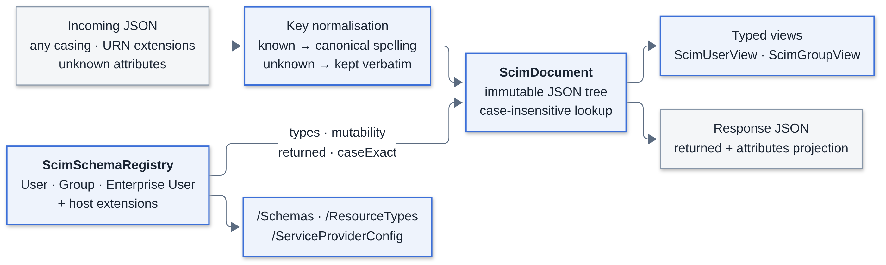
*Figure 5. One schema registry drives validation, output and discovery for every document*

One `ScimSchemaRegistry` per server configuration holds the `Schema` and `ResourceType` definitions. Everything that needs schema knowledge reads from it:

- Validation of types (string, boolean, decimal, integer, dateTime, reference, binary, complex), `required`, and `canonicalValues`.
- Mutability enforcement (readOnly, readWrite, immutable, writeOnly) in PATCH and PUT, done once and centrally.
- `returned` handling (always / never / default / request), plus the `attributes` and `excludedAttributes` parameters on every operation that returns a resource, including POST, PUT and PATCH responses ([RFC 7644 §3.9](https://www.rfc-editor.org/rfc/rfc7644#section-3.9)).
- `caseExact` for filter evaluation and for the case rules the host applies to uniqueness. The interop draft requires filter matching and uniqueness to use the same rules: `userName` case-insensitive, `id` and `externalId` case-exact.
- Discovery: `/Schemas`, `/ResourceTypes` and the capability bits of `/ServiceProviderConfig` are rendered from the registry, so they cannot drift from what the library enforces. SCIMple does the same ([directory-scimple](https://github.com/apache/directory-scimple)).

The library ships core User, Group and Enterprise User definitions. Enterprise User is registered like any host extension, with no special code path. Hosts register their own extensions at startup, and those show up in `/Schemas` automatically. The `uniqueness` characteristic is an open value type, not a closed enum, because RFC 9944 introduced new values and UnboundID 6.1.0 added constants for them ([scim2 CHANGELOG](https://github.com/pingidentity/scim2/blob/master/CHANGELOG.md)).

### 3.4 Typed views

Typed helpers are thin views over a document, not a second model:

```kotlin
val user = ScimUserView(doc)
user.userName                 // String?
user.active                   // Boolean? — absent stays null; the view does not assume true
user.primaryEmail             // derived from emails[primary eq true]
user.enterprise?.managerId    // reads urn:...:enterprise:2.0:User:manager.value

val edited = doc.edit { set(User.active, false) }   // produces a new ScimDocument
```

Writing through a view produces a new document that goes through the same validation as client input. Services that never touch typed views lose nothing.

### 3.5 Identifiers, uniqueness and correlation

Most provisioning bugs in production are identity-matching bugs, not PATCH bugs. A user is provisioned twice, provisioned from two directories, or re-provisioned after a connection is replaced. RFC 7643 keeps three identifiers apart, and so does the library ([RFC 7643 §3.1](https://www.rfc-editor.org/rfc/rfc7643#section-3.1), [§4.1.1](https://www.rfc-editor.org/rfc/rfc7643#section-4.1.1)).

| Identifier | Owned by | Rules in this library |
|---|---|---|
| `id` | Host store | Opaque and stable. Never reassigned, not even after delete, and never derived from `userName` or email. A UUID is the expected shape. |
| `externalId` | Provisioning client | Stored and returned exactly as sent (`caseExact`). Meaningful only inside the provisioning scope that sent it. Two directories may use the same value. The library never sets, rewrites or matches on it across domains. |
| `userName` | Client, validated by the server | Required. Unique within the provisioning scope and compared case-insensitively, so `Bjensen` and `bjensen` collide. |
| Group `displayName` | Client | Required. Not unique by default (the RFC does not require it). A host may enforce uniqueness per domain, as Auth0 does per connection. |

The rules:

1. **Uniqueness prevents duplicate creation; matching never adopts an account.** A POST whose `userName` already exists in the scope returns 409 `uniqueness`. It never returns or adopts the existing account. A repeated POST therefore does not get the original 201 back, so this is protection against duplicates, not idempotency. Entra and Okta both look a user up by `userName` before creating it, so a 409 should be rare, and when it happens it usually means rule 2 is broken.
2. **The uniqueness domain equals the visibility domain.** If uniqueness were tenant-wide while each connection could see only its own users, a client would search, find nothing, create, and get a 409 for a user it can never see or fix. Entra then logs the user as failed on every cycle. Figure 6 shows this trap. The library therefore takes one `ProvisioningScope` from the context (§5.3) and the store uses it for both.
3. **No implicit linking.** The library never links a SCIM resource to an existing account because an email, name or `userName` matches. That is how account takeover happens when a directory is misconfigured. Pre-existing accounts join a domain only through an explicit host policy, off by default, where every link is audited.
4. **One person, two directories, two resources.** By default each domain gets its own resource. Merging them is a host account-model decision outside SCIM.
5. **Replacing a connection does not orphan its users.** Hosts should rotate credentials on the same connection (Auth0 allows two active tokens for exactly this). When a connection really is replaced, the host offers an admin operation that moves the domain to the new connection. Otherwise the next full sync recreates every user.
6. **Deleted `id`s stay dead.** Re-creating the same person yields a new `id`, and a client holding the old one gets 404.

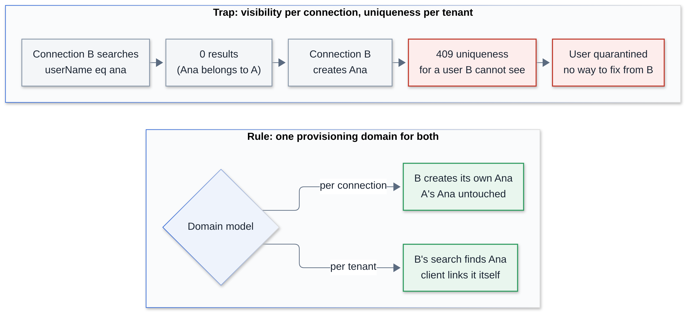
*Figure 6. The 409 trap when uniqueness and visibility use different scopes, and the rule that avoids it*

---

## 4. Library-applied PATCH and PUT

### 4.1 Pipeline

This is the core of Jake's first point. The library loads the stored document, applies the request, checks the result, and hands a finished document to the host with the version it read.

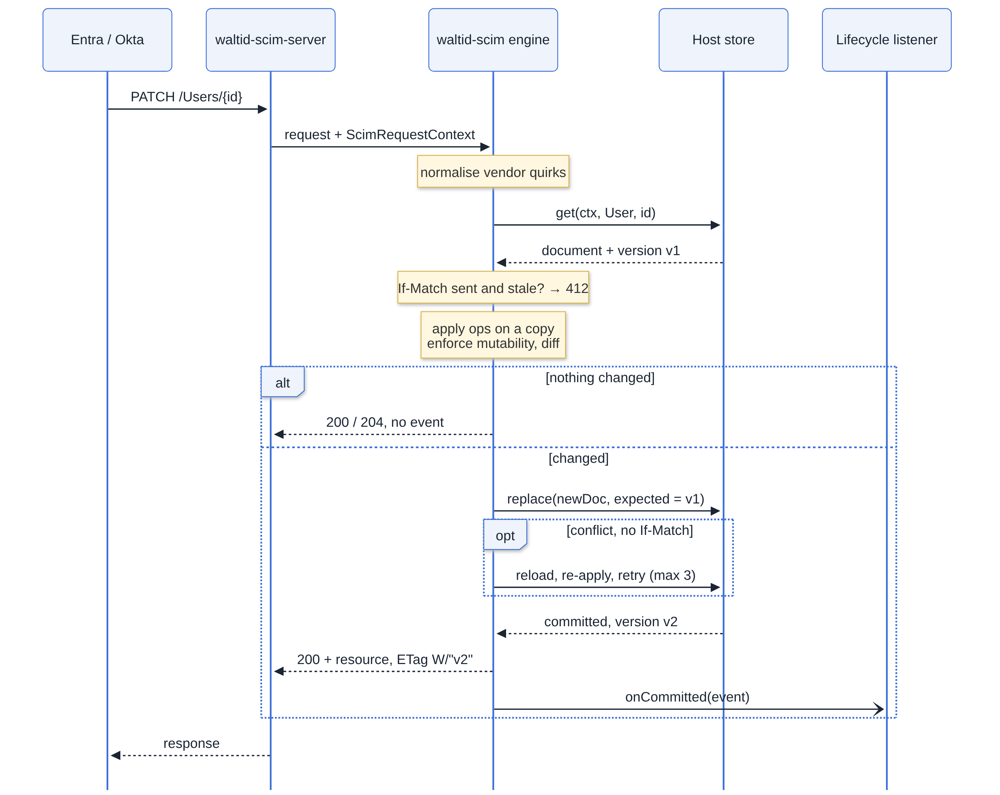
*Figure 7. PATCH flow: the library loads, applies and checks the change, the host stores it, and the event fires after commit*

The engine is a pure function, `PatchEngine.apply(doc, ops, registry, compat): PatchResult`, which works on a copy and either succeeds completely or fails with a SCIM error. That gives RFC 7644's atomicity requirement for free: ops apply in order, each sees the result of the last, and any failure leaves the stored resource untouched ([RFC 7644 §3.5.2](https://www.rfc-editor.org/rfc/rfc7644#section-3.5.2)). UnboundID, scim2-models and SCIMple all patch a copy of a tree in the same way.

After applying, the engine diffs the old and new documents. The diff decides three things: whether anything changed (if not, `meta.lastModified` and the version stay put, as RFC 7644 §3.5.2.1 requires for an add of an existing value), whether a readOnly or immutable attribute was touched, and which lifecycle events to emit.

### 4.2 PATCH semantics

The path grammar is `PATH = attrPath / valuePath [subAttr]`. A remove requires a path. Add and replace do not. There are no array indexes and no move/copy ([RFC 7644 §3.5.2](https://www.rfc-editor.org/rfc/rfc7644#section-3.5.2)). The same filter parser that serves `GET ?filter=` produces the `valuePath` filter AST. The parser follows the RFC 7644 ABNF and tolerates the documented errata: nested parentheses in `valFilter` (EID 4690/7322) and `not (` with a space (EID 7319) ([RFC 7644 errata](https://www.rfc-editor.org/errata/rfc7644)).

| Case | Behaviour | Basis |
|---|---|---|
| `add`, no path | Each key of `value` is applied as an add at that attribute | RFC §3.5.2.1 |
| `add` to multi-valued | Append. An identical value already present means no change | RFC §3.5.2.1, §2.4 |
| `add` to single-valued that exists | Replace | RFC §3.5.2.1 |
| `add` of a value already present | Success, no `meta` change, no event | RFC §3.5.2.1 (SHOULD) |
| `add`/`replace` with filtered path, e.g. `emails[type eq "work"].value` | Upsert: update the matching element in place, or create `{type:"work", value}` if none matches. `eq` filters only. More than one match gives 400 `noTarget` | Not in the RFC (EID 8097). Decision follows UnboundID with `APPEND_NEW_PATCH_VALUES_PROPERTY=false` |
| `remove`, no path | 400 `noTarget` | RFC §3.5.2.2 |
| `remove` multi-valued, no filter | All values removed | RFC §3.5.2.2 |
| `remove` with filter, nothing matches | Success, no change | RFC §3.5.2.2 members example |
| `remove` of a required or readOnly attribute | 400 `mutability` | RFC §3.5.2.2 |
| `replace`, no path | Keys of `value` are replaced | RFC §3.5.2.3 |
| `replace` of a nonexistent target | Treated as add | RFC §3.5.2.3 |
| `replace` of a singular complex attribute | Merge: given sub-attributes replaced, others kept | RFC §3.5.2.3 (the interop draft replaces wholesale; that behaviour applies only in interop-profile mode) |
| `replace` with a `valuePath` that matches nothing | 400 `noTarget` | RFC §3.5.2.3 |
| Any op that sets `primary: true` | `primary` set to false on every other value in that array | RFC §3.5.2 |
| Result has two `primary: true` values | 400 `invalidValue` | RFC 7643 §2.4. Rejection follows i2scim and scim2-models |
| Op targets a readOnly attribute | 400 `mutability` | RFC §3.5.2 |
| Op changes an immutable attribute that has a value | 400 `mutability`. An add to an unset immutable attribute is allowed | RFC §3.5.2 |
| Op addresses an extension by URN | URN added to `schemas` | RFC §3.5.2 |
| Malformed path | 400 `invalidPath` | RFC Table 9 |
| Multi-valued target would exceed the configured size | 400 `invalidValue` | Decision. UnboundID caps at 25,000 by default |

**Response.** Success returns 200 with the resource, filtered by `attributes`/`excludedAttributes`, or 204. 200 is mandatory when `attributes` was supplied ([RFC 7644 §3.5.2](https://www.rfc-editor.org/rfc/rfc7644#section-3.5.2)). The two big clients want different things for Groups. Entra expects 204 and advises against returning the member list ([Entra SCIM tutorial](https://learn.microsoft.com/en-us/entra/identity/app-provisioning/use-scim-to-provision-users-and-groups)). Okta's reference says a group PATCH response must be 200 with the group, though `members` may be null. For user deactivation Okta accepts 200 or 204 ([Okta SCIM 2.0 reference](https://developer.okta.com/docs/api/openapi/okta-scim/guides/scim-20/)). So the choice comes from the connection's compatibility profile (§9): 204 for Groups under the Entra profile, and 200 everywhere else. Under the default, a Group returned from a membership-store host omits `members`.

### 4.3 PUT semantics

PUT replaces the resource and MUST NOT create one. A PUT to an unknown id returns 404 ([RFC 7644 §3.5.1](https://www.rfc-editor.org/rfc/rfc7644#section-3.5.1)). The library loads the stored document and builds the replacement from these rules:

| Attribute class | Present in the PUT body | Omitted from the PUT body |
|---|---|---|
| readWrite | Replaces the stored value | **Cleared**. The RFC allows clearing or defaulting; v2 clears, as Jake asked |
| readOnly (`id`, `meta`, `groups`) | Ignored silently (RFC) | Kept |
| immutable | Must equal the stored value, or 400 `mutability`. Applied if no value is stored yet | Kept |
| writeOnly (e.g. `password`) | Replaces the stored value; never returned | **Kept (design decision, see below)** |
| required | Must be present, or 400 `invalidValue` | — |
| Unknown / undeclared extension | Per `UnknownAttributePolicy` (§3.2): preserved and replaces stored, dropped, or 400 `invalidSyntax` | When preserved: cleared, like readWrite |

**writeOnly is a design decision, not RFC text.** RFC 7644 §3.5.1 groups writeOnly with readWrite when a value is provided, and says omitted readWrite attributes "MAY" be cleared. It says nothing specific about omitted writeOnly attributes. v2 keeps them. A client cannot read a writeOnly value back, so it cannot echo it in a full replace. Clearing on omission would wipe every password on Okta's GET-then-PUT update cycle ([Okta SCIM 2.0 reference](https://developer.okta.com/docs/api/openapi/okta-scim/guides/scim-20/)). An explicit `null` for a writeOnly attribute is passed to the host as a clear request, and the host may refuse it. Hosts that do not manage passwords can drop `password` entirely: Okta sends it on create even when password sync is off.

readOnly input is dropped on PUT but is an error on PATCH. That asymmetry is in the RFC and is why Okta's PUT bodies carrying `id`, `meta` and `groups: []` are harmless. PUT success is 200 with the resource.

### 4.4 Optional membership-delta path for large groups

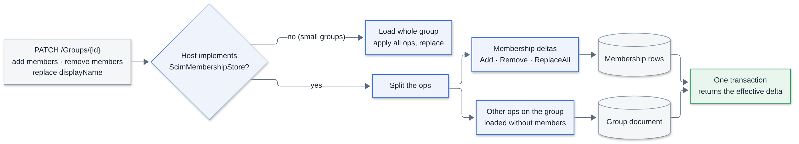
*Figure 8. Large groups: membership changes go to the host as deltas, so the member list is never loaded*

Loading and rewriting a 100,000-member `members` array for each one-member change does not work. Entra reads groups with `excludedAttributes=members`, sends each membership change as a separate PATCH, and expects 204 ([Entra SCIM tutorial](https://learn.microsoft.com/en-us/entra/identity/app-provisioning/use-scim-to-provision-users-and-groups)). Okta batches up to 1,000 members per PATCH, according to its developer forum ([Okta devforum 34187](https://devforum.okta.com/t/oin-scim-app-max-memberships-in-group-patch-api/34187), not staff-confirmed).

If the host implements `ScimMembershipStore` (§6), the engine splits a Group PATCH into two parts:

1. Ops whose target is `members` become an ordered `MembershipDelta` list: `add members`, `remove members[value eq "x"]`, Entra's remove-with-value-array, and `replace members`. These go to the host as deltas, so the full array is never loaded.
2. All other ops (Okta's `displayName` rename travels with membership changes) apply to the group document, loaded without members.

The host commits both parts in one transaction and returns the *effective* delta, meaning the ids that were actually added or removed. Re-adding an existing member or removing an absent one is a no-op success, not a 409, because Entra retries failed operations in later cycles ([How provisioning works](https://learn.microsoft.com/en-us/entra/identity/app-provisioning/how-provisioning-works)). `replace members` and Okta AIW's full-list PUT become `ReplaceAll(ids)`, which the host applies as a diff. Hosts without a membership store get the plain document path, which suits small groups.

Adds and removes that touch different members commute, so concurrent Entra PATCHes on one group rarely conflict on this path. Not everything commutes, though. `ReplaceAll`, an add and a remove of the *same* member, and a group delete all depend on order, so the store must serialise them against other changes to that group, using the group's version or a row lock. The contract kit tests each of these cases.

### 4.5 Optimistic concurrency

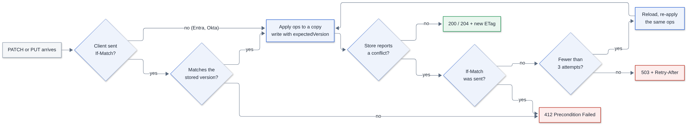
*Figure 9. How the library avoids lost updates when clients send no version*

RFC 7644 makes ETags optional. Clients MAY send `If-Match` on PUT and PATCH ([RFC 7644 §3.14](https://www.rfc-editor.org/rfc/rfc7644#section-3.14)). In practice the large clients do not. Entra's guidance never mentions it, the interop draft forbids clients from sending conditional headers, and AWS IAM Identity Center advertises `etag.supported: false` ([AWS SPC](https://docs.aws.amazon.com/singlesignon/latest/developerguide/serviceproviderconfig.html)). Entra reportedly sends about 5–10 requests in parallel. That figure comes from a community answer, not Microsoft documentation ([Microsoft Q&A 2284725](https://learn.microsoft.com/en-us/answers/questions/2284725/understanding-scim-client-request-behavior-and-exp)). Load-modify-save without a check would lose updates.

So the library uses the store's version internally, whether or not the client sends anything:

- **Client sent `If-Match`.** Compare it with the current ETag before applying. A mismatch returns **412** and the library does not retry. The comparison is weak, which is a SCIM-specific exception explained below. RFC 7644 Table 8 also lists 409 for "version mismatch". v2 treats that row as legacy wording and never emits it ([RFC 7644 §3.12](https://www.rfc-editor.org/rfc/rfc7644#section-3.12)).
- **No `If-Match`.** Call `replace(expectedVersion = versionRead)`. On a `VersionConflict`, re-load, re-apply the same ops and retry, with up to 3 attempts by default and jittered backoff. Re-applying is safe because PATCH ops are relative to current state. PUT is re-applied the same way, but the retry does not make PUT safe: it only stops a storage conflict from going unnoticed. A full replacement still overwrites whatever another client changed in between, which is what PUT without `If-Match` means. Clients that need protection against that must send `If-Match`.
- **Retries exhausted.** Return **503 with `Retry-After`** and a SCIM error body. This is a design decision. 409 would also be defensible, but I chose 503 because some clients read 409 as "duplicate". Entra already retries failed operations in later cycles.
- **`If-None-Match`** on GET returns 304 with the ETag when unchanged. Requiring `If-Match` (428) is possible per connection but off by default, because it would break mainstream clients.

**Three different values, kept apart.** The store's `version` is an opaque compare-and-set token. The HTTP `ETag` and `meta.version` are derived from it by the library. The `revision` (§6) is a separate, monotonically increasing number used only to order events. Hosts never have to make one value serve all three purposes.

**Weak ETags are a deliberate SCIM exception.** RFC 9110 requires strong comparison for `If-Match`, so a weak tag can never satisfy it under plain HTTP rules ([RFC 9110 §13.1.1](https://www.rfc-editor.org/rfc/rfc9110#section-13.1.1)). SCIM goes the other way. RFC 7644 §3.14 names weak ETags as the preferred mechanism for avoiding overwrites, and its own PUT and PATCH examples send `If-Match: W/"…"` ([RFC 7644 §3.14](https://www.rfc-editor.org/rfc/rfc7644#section-3.14)). RFC 7643 §3.1 also says a tag that is not a strong validator MUST be marked weak ([RFC 7643 §3.1](https://www.rfc-editor.org/rfc/rfc7643#section-3.1)). Ours cannot be strong, because one resource version is served as many different bodies through `attributes` and `excludedAttributes`. So the library emits weak ETags and compares `If-Match` weakly, following SCIM, and the documentation names this as a departure from RFC 9110 rather than calling it standard HTTP behaviour. `If-None-Match` uses weak comparison, as RFC 9110 already allows.

**Conditional writes are mandatory for production.** A store must implement `replace`, `delete` and `patchGroup` as atomic conditional writes. An in-process lock cannot protect two server instances writing to one shared store, so a store without conditional writes declares `ConcurrencyMode.SINGLE_WRITER_ONLY`. The server then refuses to start unless the deployment explicitly sets `singleWriter = true`, which is meant for development, tests and genuinely single-instance installs. A backend API that has no compare-and-set needs its own reliable serialisation, such as a distributed lock with fencing tokens or a single authoritative writer service. SPC advertises `etag.supported` only when the store supplies versions.

### 4.6 Group membership consistency

The membership path in §4.4 says how changes reach the store. These rules say what a valid result is. Both store paths (whole document and membership deltas) must satisfy them, and the contract test kit checks them (§13).

| Situation | Rule | Basis |
|---|---|---|
| Member `value` refers to a user that does not exist, or is outside the caller's scope | 400 `invalidValue`. The whole PATCH fails and nothing is written | Decision. Silently dropping the member would hide a client bug; the reference must resolve in the same domain (§5.3) |
| Same member added twice, in one request or across requests | Set semantics. Stored once; the second add is a no-op success | RFC 7644 §3.5.2.1, Entra retry behaviour |
| Member of `type: Group` (nested groups) | 400 `invalidValue` unless the store declares `nestedGroups` (§7.5) | Decision: direct membership only in Phase 1, as the reviewer suggested |
| User deleted | The store removes that user's memberships in the same transaction. Each affected group gets a new version and a `MembershipChanged` event | Decision. Avoids dangling references in `members` |
| User deactivated | Memberships are kept. Deactivation is not deletion | UC1 |
| Group deleted | Memberships removed; affected users' `groups` change on next read | RFC 7643 §4.1.2 (`groups` is derived) |
| User `groups` attribute | readOnly and computed by the store from membership at read time. A PATCH on it is 400 `mutability`; a PUT ignores it | RFC 7643 §4.1.2 |
| Distributed or partial failure | Not allowed. All membership changes in one request commit together or not at all. A backend that cannot do that must reject the request | RFC 7644 §3.5.2 atomicity |
| Large removal by the old Entra shape (`remove members` with a value list) | Removes only the listed members, never the whole group | §9.2 |

### 4.7 Reading large groups

The membership store in §4.4 stops writes from loading the whole member list. It does nothing for reads: a `GET /Groups/{id}` that includes `members` still has to load and serialise every member. The read side therefore has its own contract.

| Situation | Behaviour |
|---|---|
| Client excludes members (`excludedAttributes=members`, as Entra does) | The member list is never touched |
| Members requested and the group is within `maxInlineMembers` (default 10,000, configurable) | Full list, read from one consistent snapshot |
| Members requested and the group is larger | 400 `tooMany`, with a `detail` telling the client to use `excludedAttributes=members` or a member filter. This is a decision: RFC 7644 has no paging for members, and `tooMany` is the closest error it defines |
| Store declares it cannot serve member-heavy reads | `maxInlineMembers` can be set lower, down to 0, and the limit is documented for that adapter |
| Membership check, e.g. `GET /Groups?filter=id eq "g1" and members[value eq "u1"]` | Answered through `ScimMembershipStore.isMember` without loading the list |

The library never returns a partial `members` array as if it were the whole group. That would read to the client as "these are all the members", and its next sync would remove everyone missing from the page.

Member reads go through `readMembers` (§6), which must return either the complete list from a single consistent snapshot or `TooMany(count)`. Pages may not be stitched together across versions. If the store cannot read in one snapshot, it compares the group version before and after reading and retries once, then fails with 503.

---

## 5. Request context and tenancy

### 5.1 `ScimRequestContext`

Every SPI call and every lifecycle event receives the context:

```kotlin
data class ScimRequestContext(
    val tenantId: String,
    val connectionId: String,            // the directory connection (one IdP config) inside the tenant
    val scope: ProvisioningScope,        // tenantId + domainId; every store call uses both (§5.3)
    val principal: ScimPrincipal,        // who authenticated
    val permissions: Set<ScimPermission>,// what this credential may do; checked per operation (§5.3)
    val requestId: String,               // server-generated; adopts inbound traceparent/X-Request-ID if present
    val baseUri: Url,                    // per-connection SCIM base, used for meta.location
    val preconditions: Preconditions,    // If-Match / If-None-Match, parsed
    val compat: CompatProfile,           // resolved per connection (§9)
    val userAgent: String?,              // e.g. "Okta SCIM Client 1.0.0"
)

/** Never compare domainId alone: two tenants may both have a connection called "entra-prod". */
data class ProvisioningScope(val tenantId: String, val domainId: String)

data class ScimPrincipal(
    val subject: String,                 // client id, token subject, or WIF issuer+sub
    val credentialId: String?,           // which token/secret — for audit across rotation
    val scopes: Set<String>,             // e.g. per-operation scopes
    val method: AuthMethod,              // STATIC_BEARER, OAUTH_CLIENT_CREDENTIALS, JWT_ASSERTION, ...
)
```

No SCIM-specific request-id header is standardised, and the major clients do not depend on one being echoed. The request id is mainly for the operator's logs and for tracing events back to the request that caused them, which is how WorkOS links requests and events ([WorkOS: making SCIM debuggable](https://workos.com/blog/making-scim-debuggable)). The server module echoes it in a response header.

### 5.2 Resolution: per-connection base path and credentials

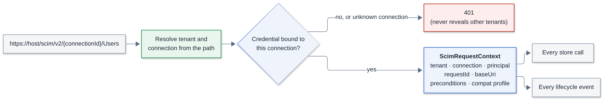
*Figure 10. Resolving tenant and connection, and building the request context*

RFC 7644 acknowledges multi-tenant providers but defines no mechanism for resolving the tenant. I could not retrieve the §6 body text, so this point is unverified beyond the table of contents. The industry norm is clear, though. The connection goes in the URL and each connection has its own credential:

| Provider | Endpoint shape | Credential |
|---|---|---|
| Okta (inbound) | `https://{oktaDomain}/{connectionId}/scim/v2` | Opaque bearer per connection ([Okta](https://developer.okta.com/docs/api/openapi/okta-scim/inbound/overview)) |
| AWS IAM Identity Center | `https://scim.{region}.amazonaws.com/{tenant_id}/scim/v2/` | Bearer. Wrong tenant id returns 401 ([AWS](https://docs.aws.amazon.com/singlesignon/latest/developerguide/serviceproviderconfig.html)) |
| GitHub EMU | `/scim/v2/enterprises/{enterprise}/` | PAT or GitHub App token ([GitHub](https://docs.github.com/en/enterprise-cloud@latest/rest/enterprise-admin/scim)) |
| WorkOS | Directory-specific path segment | Per-directory bearer, rotatable ([WorkOS](https://workos.com/docs/integrations/scim.md)) |
| Auth0 | Endpoint per enterprise connection | Up to two active tokens per connection, with per-operation scopes ([Auth0](https://auth0.com/docs/authenticate/protocols/scim/configure-inbound-scim.md)) |

Entra is moving the same way from the client side. Long-lived bearer tokens are no longer accepted for new apps. Gallery apps must use OAuth 2.0 client credentials or workload identity federation (an RFC 7523 JWT assertion), and every customer must have its own client credentials ([Entra SCIM tutorial](https://learn.microsoft.com/en-us/entra/identity/app-provisioning/use-scim-to-provision-users-and-groups); [App Gallery requirements](https://learn.microsoft.com/en-us/entra/identity/enterprise-apps/app-gallery-user-provisioning-requirements)).

**Recommendation.** A per-connection base path (`/scim/v2/{connectionId}/…` or a host-defined template) plus per-connection credentials. Resolution is pluggable in the server module:

```kotlin
fun interface ScimContextResolver {
    suspend fun resolve(call: ApplicationCall): ScimRequestContext   // throws ScimException(401) on failure
}
```

The default resolver reads the connection id from the path, authenticates the request with the host's configured authenticator (static bearer, OAuth access-token validation, or JWT assertion), and **requires the credential to be bound to that connection**. Two cases return **401**, the AWS behaviour: an unknown connection, and a credential that belongs to a different connection. That way the server never confirms that another tenant exists. The resolver also tolerates Entra's `aadOptscim062020` token and a trailing slash in the base URL (§9). Slack-style token-derived tenancy (one global URL) is supported by a resolver that reads the claim instead of the path.

Uniqueness scope is the host's choice and the context carries both ids. Auth0, for instance, scopes group `displayName` uniqueness per connection.

### 5.3 Authorization and isolation

Authentication tells the library which connection is calling. Authorization decides what that connection may touch. v2.0 had the first and left the second implicit. There are two layers, and they are enforced in different places.

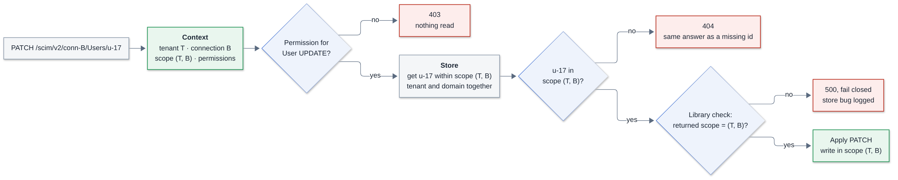
*Figure 11. Two checks on every request: the library checks the operation, the store checks the data, and the library verifies the store's answer*

**Operation authorization, enforced by the library.** Before calling the store, the engine checks `ctx.permissions` for the resource type and action:

```kotlin
data class ScimPermission(val resourceType: ResourceTypeId, val action: Action) {
    enum class Action { READ, CREATE, UPDATE, DELETE }   // GET/search, POST, PUT/PATCH, DELETE
}
```

A missing permission returns 403 with a SCIM error body, before any data is read. Entra and Okta tokens carry no scopes, so the default for a credential without scopes is full access within its own connection. A host narrows that, for example to a read-only audit connection, the way Auth0 offers per-operation scopes. Discovery endpoints need no permission.

**Data isolation, enforced by the store and verified by the library.** The library cannot see the host's data, so it cannot filter rows itself. The SPI contract makes isolation mandatory instead:

- Every store method evaluates visibility against the full `ctx.scope`, meaning tenant and domain together. A resource outside the scope must look exactly like a missing one: `get` returns null (404), `replace` and `delete` raise `NotFound` (404), and `search` neither returns nor counts it. Returning 404 rather than 403 means a caller cannot probe for ids in other scopes.
- The scope is recorded on create and cannot change through SCIM. Moving resources between domains is the admin operation from §3.5.
- Member references resolve in the same scope (§4.6), and uniqueness uses the same scope (§3.5).
- **The scope is one value, not two strings.** Connection ids are only unique inside a tenant: tenant A and tenant B can both have a connection called `entra-prod`. If a store partitioned by domain alone, the default per-connection domain would merge them. `ProvisioningScope` carries both parts, its equality covers both, and adapters key every query, uniqueness index and membership lookup on the whole value.
- **Defence in depth.** Every `StoredResource` carries its scope (§6). The engine compares the whole scope with the context before using or returning anything. A mismatch fails closed with 500 and an error log, so a store bug cannot leak another connection's user into a response.
- The contract test kit (§13) runs cross-connection read, write, delete, search, filter and membership attempts against any adapter. An adapter does not pass review without it.

**Choosing the domain.** The host's `ScimContextResolver` sets `scope.domainId` (the tenant part always comes from the authenticated connection). Two models cover the cases I know of:

| Model | `scope.domainId` | Fits |
|---|---|---|
| Per connection (default) | `connectionId` | Several independent directories feeding one tenant, such as two subsidiaries |
| Per tenant | `tenantId` | One directory reached through more than one connection, such as during a migration |

Mixing the two inside one tenant is not supported, because it breaks the visibility-equals-uniqueness rule.

---

## 6. Host SPI

The host persists documents and assigns ids. The library assigns nothing the host owns, and the host never interprets PATCH. Signatures are illustrative.

```kotlin
interface ScimResourceStore {
    /** Host assigns `id` and the initial version. `doc` already carries meta.created/lastModified/resourceType. */
    suspend fun create(ctx: ScimRequestContext, type: ResourceTypeId,
                       doc: ScimDocument, events: PendingEvents): StoredResource

    suspend fun get(ctx: ScimRequestContext, type: ResourceTypeId, id: String,
                    projection: Projection): StoredResource?          // projection lets host skip `members`

    suspend fun search(ctx: ScimRequestContext, type: ResourceTypeId, query: ScimQuery): ScimPage

    /** Atomic compare-and-set on expectedVersion; throws VersionConflict. */
    suspend fun replace(ctx: ScimRequestContext, type: ResourceTypeId, id: String,
                        doc: ScimDocument, expectedVersion: String, events: PendingEvents): StoredResource

    /** Honours If-Match through expectedVersion. Removes the resource's memberships in the same transaction (§4.6). */
    suspend fun delete(ctx: ScimRequestContext, type: ResourceTypeId, id: String,
                       expectedVersion: String?, events: PendingEvents): DeleteResult

    /** What this store can really do; drives routes and discovery (§7.5). */
    val capabilities: StoreCapabilities

    /** CONDITIONAL is required for any multi-instance deployment (§4.5). */
    val concurrency: ConcurrencyMode get() = ConcurrencyMode.CONDITIONAL
}
enum class ConcurrencyMode { CONDITIONAL, SINGLE_WRITER_ONLY }

/**
 * `scope` is compared with ctx.scope before use (§5.3).
 * `version` is the opaque compare-and-set token; the library derives ETag and meta.version from it (§4.5).
 * `revision` increases by at least 1 on every committed change to this resource; events are ordered by it (§10.2).
 */
data class StoredResource(val id: String, val version: String, val revision: Long,
                          val scope: ProvisioningScope, val doc: ScimDocument)
data class DeleteResult(val affectedGroups: Map<String, String> = emptyMap())   // groupId → new version

data class ScimQuery(
    val filter: Filter?,                 // parsed AST, attribute refs resolved against the registry (incl. caseExact)
    val sortBy: AttributePath?, val sortOrder: SortOrder?,
    val startIndex: Int, val count: Int, // already clamped by the library (§7.4)
    val projection: Projection,
)
data class ScimPage(val totalResults: Int, val resources: List<StoredResource>)  // stable order required

/** Optional: large-group membership without materialising `members`. */
interface ScimMembershipStore {
    suspend fun patchGroup(ctx: ScimRequestContext, groupId: String,
                           groupDoc: ScimDocument?,            // non-member changes, if any
                           deltas: List<MembershipDelta>,       // in request order
                           expectedVersion: String?, events: PendingEvents): MembershipResult
    /** Complete list from one consistent snapshot, or TooMany. Never pages stitched across versions (§4.7). */
    suspend fun readMembers(ctx: ScimRequestContext, groupId: String, limit: Int): MembersRead
    suspend fun isMember(ctx: ScimRequestContext, groupId: String, memberId: String): Boolean
}
sealed interface MembersRead {
    data class Complete(val members: List<MemberRef>, val version: String) : MembersRead
    data class TooMany(val count: Long) : MembersRead
}
sealed interface MembershipDelta {
    data class Add(val ids: List<String>) : MembershipDelta
    data class Remove(val ids: List<String>) : MembershipDelta
    data class ReplaceAll(val ids: List<String>) : MembershipDelta
}
data class MembershipResult(val version: String, val revision: Long, val added: Set<String>, val removed: Set<String>)

/** Lifecycle hooks, see §10. */
fun interface ScimLifecycleListener { suspend fun onCommitted(event: ScimLifecycleEvent) }
```

Notes on the contract:

- **Filters arrive as an AST**, not a string. Each `AttributePath` is already resolved to its definition, so the host knows whether `userName eq "X"` compares case-insensitively. The library also ships an in-memory evaluator for tests and small stores. Entra uses only `eq` and `and` ([Entra SCIM tutorial](https://learn.microsoft.com/en-us/entra/identity/app-provisioning/use-scim-to-provision-users-and-groups)), and Okta filters `userName eq` and `displayName eq`. A host may reject other operators with 400 `invalidFilter`, and SPC says what is supported.
- **Uniqueness** is enforced atomically by the store. The store throws `UniquenessConflict`, and the library turns it into 409 `uniqueness`. The library cannot check uniqueness race-free itself.
- **Stable ordering.** Okta requires stable order across pages. The store must order deterministically, for example by `id`, when no sort is requested.
- **`PendingEvents`** carries the events the library computed before commit. A store that runs a transactional outbox calls `events.finalize(id, newVersion)` and writes the rows in the same transaction (§10). Other stores ignore it.
- **Isolation is part of the contract.** Every method scopes by the full `ctx.scope`, and out-of-scope resources behave as missing (§5.3).
- **Opaque data is marked.** Attributes kept under `PRESERVE_OPAQUE` reach the store flagged as client-supplied and unvalidated (§3.2).
- **No auth, no HTTP.** The SPI lives in the protocol module and knows nothing about Ktor.

---

## 7. Protocol bookkeeping

### 7.1 `meta`

All `meta` sub-attributes are assigned by the service provider. Client-supplied `meta` is ignored: Entra sends `meta.resourceType` on creates ([RFC 7643 §3.1](https://www.rfc-editor.org/rfc/rfc7643#section-3.1)).

| Sub-attribute | Set by | When |
|---|---|---|
| `resourceType` | Library | From the endpoint (POST /Users gives "User") |
| `created` | Library | On create, from an injectable clock |
| `lastModified` | Library | Equals `created` initially. Bumped only when the diff shows a real change |
| `location` | Library, at render time | `ctx.baseUri` + endpoint + id. Also sent as the `Location` header (201) and `Content-Location` |
| `version` | Store-owned token, rendered by the library | `W/"<token>"`, mirrored in the `ETag` header |

`location` and `version` are computed when the response is rendered, not stored. A base-URL change therefore needs no data migration. `id` comes from the host, and `externalId` is client-owned: the library never sets it.

### 7.2 Discovery

`/ServiceProviderConfig`, `/ResourceTypes`, `/ResourceTypes/{name}`, `/Schemas` and `/Schemas/{urn}` are generated from the registry plus the server configuration. The rules:

- They ignore filter, sort and paging. A `filter` parameter returns 403, as UnboundID and scim2-server do ([RFC 7644 §4](https://www.rfc-editor.org/rfc/rfc7644#section-4)).
- `/Schemas` lists every schema referenced from `/ResourceTypes`. Entra's gallery validation fails the Group tests outright if the Group schema is missing ([Validate user provisioning](https://learn.microsoft.com/en-us/entra/identity/enterprise-apps/validate-user-provisioning-app-gallery)).
- SPC contents come from the capability profile (§7.5): `patch.supported: true`, `bulk.supported: false`, `filter.supported: true` with `maxResults` equal to the max page size, `changePassword.supported: false` unless the host opts in, `sort.supported` and `etag.supported` as the store declares (§4.5), and `authenticationSchemes` from the server's authenticator configuration ([RFC 7643 §5](https://www.rfc-editor.org/rfc/rfc7643#section-5)). The RFC says SPC SHOULD be reachable without authentication, so the routes module allows that as a configurable option.
- Each ResourceType's `id` equals its `name`, as the interop draft requires.

### 7.3 Errors

`ScimException` extends `id.walt.errors.StatusException` from `waltid-library-commons`, so walt.id services that already map `HttpStatusError` keep working. Its body follows RFC 7644 §3.12: the `urn:ietf:params:scim:api:messages:2.0:Error` schema, `status` as a JSON **string**, optional `scimType`, and optional `detail`. `scimType` is an open string with known constants, because RFC 9865 has already added three.

| Condition | HTTP | `scimType` | Note |
|---|---|---|---|
| Bad filter / unsupported operator | 400 | `invalidFilter` | |
| Filter result too large | 400 | `tooMany` | |
| Malformed body / unknown attribute under `REJECT` / conflicting duplicate keys | 400 | `invalidSyntax` | |
| Bad PATCH path | 400 | `invalidPath` | |
| PATCH target missing (§4.2 cases) | 400 | `noTarget` | |
| Wrong type, missing required, two primaries | 400 | `invalidValue` | |
| readOnly/immutable violation | 400 | `mutability` | |
| Unsupported `/v{n}` | 400 | `invalidVers` | |
| Uniqueness conflict on create/PUT/PATCH | **409** | `uniqueness` | Table 9 lists it under 400, but §3.3 says MUST be 409. Entra and Okta expect 409 |
| Sensitive data in the URI | **403** | `sensitive` | Table 9 lists it under 400, but §7.5.2 says SHOULD 403 (erratum EID 6893 fixed the example) |
| `If-Match` mismatch | **412** | — | Not 409, despite Table 8 (§4.5) |
| Unknown resource | 404 | — | |
| `/Me`, `/Bulk` | 501 | — | |
| Rate limited | 429 + `Retry-After` | — | Server module |
| Concurrency retries exhausted | 503 + `Retry-After` | — | Design decision (§4.5) |
| Cursor errors, if RFC 9865 is ever added | 400 | `invalidCursor`, `expiredCursor`, `invalidCount` | [RFC 9865 §2.1](https://www.rfc-editor.org/rfc/rfc9865.html) |

Unexpected host exceptions become 500 with a generic `detail`. The stack trace goes to the log and never to the client.

### 7.4 Pagination

Index paging is 1-based and stateless ([RFC 7644 §3.4.2.4](https://www.rfc-editor.org/rfc/rfc7644#section-3.4.2.4)):

- `startIndex < 1` is treated as 1. A negative `count` is treated as 0, and `count=0` returns only `totalResults`.
- A missing `count` gets the library default. **Proposal: default 100, max 1,000, configurable.** 100 matches what Okta sends and the interop draft's floor. The max is an open question (§15).
- A `count` above the max is clamped silently, not rejected. That is allowed because the server MAY return fewer.
- `totalResults`, `startIndex` and `itemsPerPage` are always emitted as integers (Okta requires integers), and `startIndex` echoes the request. Entra's validator checks `startIndex == page*5+1` ([validator overview](https://github.com/AzureAD/SCIMReferenceCode/blob/master/Microsoft.SCIM.LogicAppValidationTemplate/StandardLogicApp/SCIM-Validation-Test-Overview.md)).
- A filter with no matches returns **200 with `totalResults: 0`**, never 400 or 404. Entra's Test Connection depends on this ([App Gallery requirements](https://learn.microsoft.com/en-us/entra/identity/enterprise-apps/app-gallery-user-provisioning-requirements)).

Cursor paging (RFC 9865, October 2025) is deferred. The `ScimQuery` paging fields will become a sealed `PageRequest` (`Index` | `Cursor`) when it is added, and SPC will gain the `pagination` block.

### 7.5 Capability profile

The same library will sit in front of stores that can do different things. One adapter supports Groups and ETags; another supports only Users. Discovery must describe the store that is actually there, because Entra's and Okta's test suites read SPC and `/ResourceTypes` and then test what they find.

```kotlin
data class StoreCapabilities(
    val resourceTypes: Set<ResourceTypeId>,        // only these get routes and discovery entries
    val filterOperators: Set<FilterOp>,            // e.g. EQ, AND for a minimal store
    val filterableAttributes: Set<AttributePath>,  // what the store can query efficiently
    val sortableAttributes: Set<AttributePath>,    // empty → sort.supported = false
    val etag: Boolean,                             // store supplies comparable versions
    val membershipStore: Boolean,                  // implements ScimMembershipStore (§4.4)
    val nestedGroups: Boolean = false,             // §4.6
    val changePassword: Boolean = false,
)
```

How it is used:

- **One source.** SPC, `/ResourceTypes`, `/Schemas` and the routes all derive from this object plus server configuration. Configuration may narrow it (for example, hide Groups) but never widen it. The server refuses to start if configuration claims something the store does not declare.
- **Routes follow it.** A store without Groups gets no `/Groups` routes, and requests there return 404. Group schemas then do not appear in `/Schemas` either, which keeps Entra's validator from running Group tests the host cannot pass.
- **Parsing is separate from querying.** The parser always accepts the full RFC 7644 grammar. The engine then checks the parsed filter against `filterOperators` and `filterableAttributes` before the store sees it. Anything outside them returns 400 `invalidFilter` with a `detail` naming the unsupported part, rather than a store-level failure or a full scan.
- **Minimum for the big clients.** For User: `eq` and `and` on `userName`, `externalId` and `id`. For Group: `eq` on `displayName`, `externalId` and `id`. That is what Entra sends ([Entra SCIM tutorial](https://learn.microsoft.com/en-us/entra/identity/app-provisioning/use-scim-to-provision-users-and-groups)) and what Okta needs. The contract test kit warns when a store declares less.

### 7.6 Wire format

The rules a correct Kotlin implementation can still get wrong at the HTTP layer. The routes module owns them; the engine supplies the bodies.

| Item | Rule |
|---|---|
| Response `Content-Type` | Always `application/scim+json; charset=utf-8` ([RFC 7644 §3.1](https://www.rfc-editor.org/rfc/rfc7644#section-3.1)) |
| Request `Content-Type` | Accept `application/scim+json` and `application/json`, since Okta and OneLogin send the latter (§9.2). Anything else is 415 in RFC and interop-profile modes, parsed as JSON in lenient mode |
| List responses | `schemas: ["urn:ietf:params:scim:api:messages:2.0:ListResponse"]`, `totalResults`, `startIndex`, `itemsPerPage` as integers, and `Resources` with a capital R. An empty result still sends `Resources: []` (decision; both clients accept it) |
| POST success | 201 with the resource, `Location` equal to `meta.location`, and `ETag` when versions are supported |
| GET, PUT, PATCH success | 200 with the resource. PATCH may be 204 per compatibility profile (§4.2) |
| DELETE success | 204, no body. `If-Match` honoured, mismatch 412 |
| Conditional requests | `ETag` is weak and mirrors `meta.version`. 304 for an unchanged `If-None-Match`, 412 for a failed `If-Match`. `If-Match` is compared weakly, a documented SCIM exception to RFC 9110 (§4.5) |
| `attributes` / `excludedAttributes` | `returned: always` attributes (`id`, `schemas`) are always present. `returned: never` (`password`) never appears. `returned: request` appears only when named in `attributes`. If a client sends both parameters, `attributes` wins (decision) |
| Errors | Every 4xx and 5xx, including 401, 403 and 404 from the routes module, carries the SCIM error body (§7.3) |
| Timestamps | `xsd:dateTime` in UTC with a `Z` suffix |

### 7.7 Operational protections

These are implementation requirements, not SCIM extensions. The numbers are proposed defaults and all are configurable.

| Protection | Default | When exceeded |
|---|---|---|
| Request body size | 1 MB. An Okta 1,000-member PATCH is well under this | 413 with a SCIM error body |
| Operations per PATCH | 1,000 | 400 `invalidValue` |
| Values in one multi-valued attribute | 25,000 (§4.2) | 400 `invalidValue` |
| Filter length | 4,096 characters | 400 `invalidFilter` |
| Filter nesting (parentheses, `not`, `valuePath`) | 8 levels | 400 `invalidFilter` |
| Comparisons in one filter | 32 | 400 `invalidFilter` |
| Filter on an attribute the store did not declare | — | 400 `invalidFilter` (§7.5), never a full scan |
| `sortBy` on an attribute the store did not declare | — | Ignored, results stay in stable `id` order (decision) |
| Search the store cannot bound | Host's choice | 400 `tooMany` ([RFC 7644 §3.12](https://www.rfc-editor.org/rfc/rfc7644#section-3.12)) |
| Page size | 100 default, 1,000 max (§7.4) | Clamped |
| Request rate per connection | Host-configured, at least 25 requests per second per tenant (Entra's gallery requirement) | 429 with `Retry-After` |

**Audit records.** The engine emits one structured record per mutating request: request id, tenant, connection, principal and credential id, operation, resource type and id, outcome and status, and the changed attribute *paths*. It never logs attribute values, tokens or secrets. Values appear only behind an explicit debug flag, with writeOnly attributes always redacted. Where the record is stored and for how long is host policy.

---

## 8. Module layout and ownership

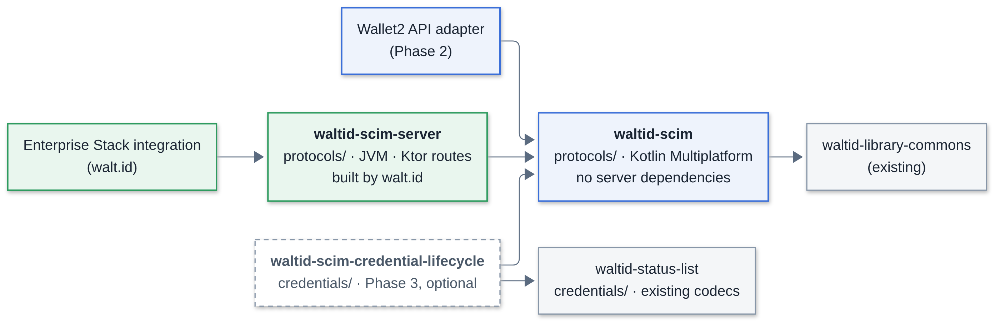
*Figure 12. Module layout and dependencies*

**`waltid-libraries/protocols/waltid-scim`.** Group `id.walt.protocols`, plugins `id("waltid.multiplatform.library")` and `id("waltid.publish.maven")`. Dependencies through `identityLibs`: kotlinx-serialization-json, kotlinx-datetime, kotlinx-coroutines-core, oshai kotlin-logging, plus `waltid-library-commons`. No Ktor, no server libraries.

*Multiplatform versus JVM.* v1 proposed JVM-first. v2 writes all code in `commonMain`, because nothing in the protocol layer needs the JVM and every other protocol module here is multiplatform. A JS or native client library (a SCIM admin tool, a test client) then gets the models, filter parser and PATCH engine for free. If the JS target turns out to cost more than it is worth, the build-logic also has a JVM-only multiplatform variant (`waltid.multiplatform.library.jvm`), and switching to it changes no source. The server module is JVM-only either way.

```text
id.walt.scim
  model/        ScimDocument, AttributePath, ListResponse, PatchRequest, ScimError, Projection
  schema/       ScimSchemaRegistry, AttributeDefinition, core User/Group/EnterpriseUser schemas
  filter/       Lexer, Parser (RFC 7644 ABNF + errata tolerance), Filter AST, InMemoryEvaluator
  patch/        PatchEngine, PathResolver, PutReplacer, DocumentDiff, MembershipSplitter
  compat/       CompatProfile, normalisers (§9), RFC-mode and interop-profile checks
  spi/          ScimResourceStore, ScimMembershipStore, PendingEvents, StoredResource, ScimQuery
  context/      ScimRequestContext, ScimPrincipal, Preconditions
  lifecycle/    ScimLifecycleEvent, ScimLifecycleListener, EventDeriver
  discovery/    ServiceProviderConfigBuilder, ResourceTypes/Schemas renderers
  engine/       ScimEngine — the transport-free entry point (create/get/search/put/patch/delete)
  errors/       ScimException, ScimType constants
```

`ScimEngine` is the seam. It takes a parsed request plus context and returns a status, headers and a body. The routes module is thin glue over it, and the engine can be tested with no HTTP at all.

**`waltid-libraries/protocols/waltid-scim-server`.** `id("waltid.jvm.library")` and `id("waltid.publish.maven")`, with ktor-server-core, content-negotiation, status-pages and the smiley ktor OpenAPI/Swagger UI descriptors, following `waltid-openid4vc-wallet-server`. It contains the route registration, `ScimContextResolver`, authenticators (static bearer, OAuth access-token validation, JWT assertion), content-type negotiation, the StatusPages mapping of `ScimException`, a rate-limit hook, and OpenAPI descriptors.

| Area | Owner |
|---|---|
| `waltid-scim` protocol module, fixtures, conformance tests | Author |
| `waltid-scim-server` Ktor routes | walt.id (offered). The author reviews against the engine contract |
| Wallet2 API adapter (Phase 2) | Author, with walt.id review |
| Enterprise Stack integration | walt.id |
| Ongoing maintenance | Shared |

---

## 9. Vendor compatibility layer

### 9.1 Three modes

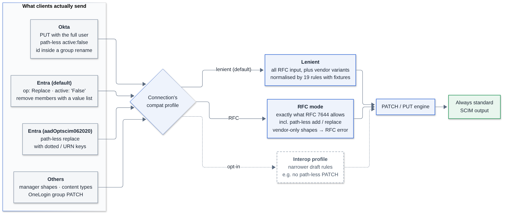
*Figure 13. Three modes: lenient accepts RFC input plus documented vendor variants, RFC mode accepts exactly what RFC 7644 allows, and the interop profile is a narrower opt-in; output is always standard*

Jake's sixth point is that the library is only as valuable as its handling of real clients. Real clients disagree with each other, and with the one serious attempt to tighten the standard. The interop draft rejects path-less PATCH, PUT and unknown attributes. Okta's own clients send path-less deactivation and use PUT for profile updates. Entra's compliant mode sends path-less replaces ([draft-zollner-scim-interop-profile-01](https://www.ietf.org/archive/id/draft-zollner-scim-interop-profile-01.html); [Okta](https://developer.okta.com/docs/api/openapi/okta-scim/guides/scim-20/); [Entra compatibility](https://learn.microsoft.com/en-us/entra/identity/app-provisioning/application-provisioning-config-problem-scim-compatibility)).

- **Lenient (default).** Everything RFC 7644 allows, plus the documented vendor variants below. Output is always standard SCIM. Tolerance applies to input only.
- **RFC.** Exactly what RFC 7643 and RFC 7644 allow, with no coercion. This includes path-less `add` and `replace`, which RFC 7644 §3.5.2.3 defines: with no `path`, the target is the resource itself ([RFC 7644 §3.5.2.3](https://www.rfc-editor.org/rfc/rfc7644#section-3.5.2.3)). Vendor-only shapes, such as dotted keys inside a path-less value or string booleans, are rejected with the RFC error. This is the conformance target, and the name is meant literally: it never rejects a request the RFC permits.
- **Interop profile (opt-in).** The narrower rules of the individual interop-profile draft, for example no path-less PATCH and whole-object replace of complex attributes. It is a profile on top of the RFC, not "strict RFC", and it rejects some RFC-valid requests by design. Advertising conformance to it waits until that draft is revived, since -01 expired on 17 Oct 2026.
- **Per-connection profile.** `CompatProfile` is resolved per connection, so a tenant can run Entra-lenient on one connection and RFC mode on another. Rules that change meaning (the "additive replace members" hazard below) are separate opt-ins and are never part of lenient-by-default.

Entra's behaviour is bimodal. The default job and the `aadOptscim062020` job send different shapes, and the compatibility page still lists the compliance fix as "TBD" ([Entra compatibility, ms.date 08/25/2025](https://learn.microsoft.com/en-us/entra/identity/app-provisioning/application-provisioning-config-problem-scim-compatibility)). Lenient mode therefore accepts both, and I expect that to stay necessary through at least 2027. Whether new tenants now default to compliant mode is unverified and needs a live tenant to check.

### 9.2 Rules

| # | Quirk (who) | Example | Lenient normalisation | RFC mode | Fixture |
|---|---|---|---|---|---|
| 1 | Capitalised `op` (Entra default; Entra validator mixes cases) | `"op":"Replace"` | Case-insensitive op | Same. Case-insensitivity is structural, and every library does this | `entra-default/patch-replace-family-name` |
| 2 | String booleans (Entra default) | `{"op":"Replace","path":"active","value":"False"}` | Coerce `"true"/"false"` (any case) when the schema type is boolean; numeric strings for integer/decimal | 400 `invalidValue` | `entra-default/patch-disable-string` |
| 3 | Remove `members` with a value array (Entra default) | `{"op":"Remove","path":"members","value":[{"value":"u1"}]}` | Remove exactly the listed members, **never wipe**. Also accept the `{"members":[…]}` wrapper (UnboundID 4.1.0) | 400 `invalidSyntax` | `entra-default/group-remove-member` |
| 4 | `"$ref": null` and `display` in member values (Entra, Okta) | `[{"$ref":null,"value":"f648…"}]` | Ignore null `$ref`. `display` is accepted and not authoritative | Same (valid JSON per schema) | `entra-default/group-add-member`, `okta-oin/group-membership` |
| 5 | Path-less replace with dotted and URN keys (Entra flag) | `{"op":"replace","value":{"name.givenName":"K","urn:…:enterprise:2.0:User:employeeNumber":"A"}}` | Expand each key into a path op. Also accept a URN container object (elimity #207) | 400 `invalidSyntax` for dotted or fully qualified keys. A path-less replace with plain attribute names, or with the extension nested under its URN, is accepted | `entra-flag/patch-multi-replace` |
| 6 | Path-less `{"active":false}` (Okta OIN deactivate) | `{"op":"replace","value":{"active":false}}` | Standard RFC path-less replace | Accepted (RFC 7644 §3.5.2.3). Only the interop profile rejects it | `okta-oin/user-deactivate` |
| 7 | `id` inside path-less value (Okta group rename) | `{"op":"replace","value":{"id":"abf4…","displayName":"X"}}` | Drop `id` if it equals the URL id. Otherwise 400 `mutability` | 400 `mutability` | `okta-oin/group-rename` |
| 8 | Filtered-path upsert (Entra) | `{"op":"Replace","path":"emails[type eq \"work\"].value","value":"a@b"}` with no work email | Create `{type:"work",value}`. Update in place if one exists (§4.2) | 400 `noTarget` | `entra-default/patch-work-email-upsert` |
| 9 | Manager shapes (Entra tutorial, validator, WorkOS report) | `path:"manager"` with `[{"value":"id"}]`; `…:User:manager` with `{"value":"id"}`; `…:manager.value` with `"id"`; bare string; `""` | Normalise to enterprise `manager.value`. `""`/`null` clear it. Response under the enterprise extension | Only `…:User:manager[.value]` with the RFC shape | `entra-validator/manager-set-change-remove`, `entra-tutorial/manager-array` |
| 10 | Empty string / null to clear (Entra validator) | `{"op":"replace","path":"nickName","value":""}` | Under the Entra profile only, and only for the attributes that profile lists, `""` unassigns. Elsewhere `""` is an ordinary value, because an empty string can be meaningful. `null` always unassigns a non-required attribute | `null` only | `entra-validator/null-update` |
| 11 | Okta GET-then-PUT full replace (OIN attributes; AIW everything) | PUT body with `id`, `meta`, `groups:[]`, `password` | §4.3 rules. readOnly ignored, writeOnly kept if omitted | Same (RFC) | `okta-aiw/user-put`, `okta-oin/user-create` |
| 12 | Full-list `replace members` (Okta) and AIW group PUT | `{"op":"replace","path":"members","value":[…]}` | `ReplaceAll` applied as a diff (§4.4) | Same | `okta-oin/group-push-replace`, `okta-aiw/group-put` |
| 13 | Entra add-then-replace double PATCH (reported, unresolved) | `add members [u]` then `replace members [u]` | **No default change.** RFC replace semantics apply. Opt-in `entraReplaceMembersAsAdditive` per connection, off by default, documented as a hazard | Off | `entra-flag/double-patch-hazard` (documents the risk) |
| 14 | Read-only or foreign data in POST (Entra, Okta) | `meta.resourceType`, ADSCIM group URN, `groups:[]`, `roles:[]` | Ignore readOnly. Undeclared extension handled by `UnknownAttributePolicy` (§3.2), opaque by default | 400 `invalidSyntax` for undeclared URNs | `entra-default/group-create`, `okta-oin/user-create` |
| 15 | No-match lookup (Entra Test Connection, Okta) | `filter=userName eq "<random guid>"` | 200 with `totalResults:0`, integer paging fields | Same | `entra/test-connection`, `okta/user-exists` |
| 16 | Content-Type variety (Okta samples show none on requests; OneLogin wants `application/json` responses) | `text/json;charset=UTF-8`, missing header | Accept `application/scim+json`, `application/json`, `text/json`, with or without charset or header. Respond `application/scim+json`, with a per-connection override | Accept `application/scim+json` and `application/json` only | `transport/content-types` |
| 17 | URL noise (Entra) | trailing `/`, `aadOptscim062020` in the Tenant URL | The resolver strips it. Exact flag syntax is undocumented, so the resolver tolerates both query and path forms | Same | `transport/entra-flag-in-url` |
| 18 | Raw `Authorization: <token>` with no scheme (Okta OIN "Header" auth) | `Authorization: abc123` | Server-module authenticator option | Off | `auth/okta-header-token` |
| 19 | OneLogin group PATCH without `Operations`, SCIM 1.1 URNs, 400 on duplicate group | `"members":[{"value":"X","operation":"remove"}]` | Optional `OneLoginProfile` adapter only, never in default lenient mode | Off | `onelogin/group-patch` |

Rows 1–8 have direct precedent in mature libraries: UnboundID's capitalised ops, value-filter add and remove-with-value; SCIMple's Azure remove quirk; elimity's `SetAllowStringValues` and `id` stripping; SCIM-SDK's Azure workaround flags. Several were added during 2025–26, which shows the shapes are still live in production traffic ([scim2 CHANGELOG](https://github.com/pingidentity/scim2/blob/master/CHANGELOG.md); [elimity-com/scim](https://github.com/elimity-com/scim); [SCIM-SDK PatchConfig](https://github.com/Captain-P-Goldfish/SCIM-SDK/blob/main/scim-sdk-common/src/main/java/de/captaingoldfish/scim/sdk/common/resources/complex/PatchConfig.java)).

Capitalised sub-attribute names, such as Entra's `emails[type eq "other"].Value` mapping, are not a quirk. Case-insensitive names are standard RFC behaviour.

### 9.3 Test strategy for quirks

- **Fixture corpus.** Each rule has request/expected-response pairs under `src/commonTest/resources/fixtures/{client}/{case}.json`, run against the engine with an in-memory store, in all three modes. Sources, in order of preference:
  1. **Sanitized real traffic from walt.id's Enterprise customers.** I am asking walt.id for this (§15). It is the most valuable input we can get.
  2. **Payloads transcribed from vendor documentation** (Entra tutorial and compatibility page, Okta SCIM reference, Entra validator workflow JSON). Short protocol examples, rewritten as fixtures.
  3. **Recorded fixtures from open-source libraries**, for example elimity-com/scim's `internal/idp_test/testdata/azuread` and `okta` replay sets. We reuse these **only after checking that each project's licence is compatible with the walt.id repository's licence**, and with attribution. I have not done that check yet.
- **Microsoft tooling.** The SCIM Validator (scimvalidator.microsoft.com) for quick checks. The Entra App Gallery Logic App validation (25 tests, including null update, manager, pagination with `count=5` and schema discoverability) is the real bar ([Validate user provisioning](https://learn.microsoft.com/en-us/entra/identity/enterprise-apps/validate-user-provisioning-app-gallery)). Its 11 direct-HTTP compliance tests get reproduced as parity tests in CI.
- **Okta tooling.** The Runscope SCIM 2.0 spec and CRUD suites, plus the manual OIN test plan ([Okta: test SCIM](https://developer.okta.com/docs/guides/scim-provisioning-integration-test/main/)), including the all-caps `userName` case test.
- **Live tenants.** An Entra test tenant in both default and `aadOptscim062020` modes, and an Okta developer org with both OIN-style and AIW apps. These confirm what the docs do not settle: the flag default for new tenants, Okta reactivation payloads, and Content-Type on Okta writes.

---

## 10. Lifecycle callback

### 10.1 Events

Jake asked for a small callback that fires after a successful deactivate, reactivate, delete or membership change. The library derives events from the before/after diff of a committed write:

| Event | Derived from | RFC 9967 name |
|---|---|---|
| `Created` | POST committed | `prov:create` |
| `Activated` | `active` false → true | `prov:activate` |
| `Deactivated` | `active` true → false | `prov:deactivate` |
| `Deleted` | DELETE committed | `prov:delete` |
| `MembershipChanged` | Effective add/remove on `members` | `prov:patch` / `prov:put` on the Group |
| `Updated` | Any other effective change, carrying the changed attribute paths | `prov:patch` / `prov:put` |

The names line up with RFC 9967, the SCIM Profile for Security Event Tokens (May 2026). It defines `prov:create/patch/put/delete/activate/deactivate` under the `urn:ietf:params:scim:event:` prefix, with notice and full variants for create/patch/put ([RFC 9967](https://www.rfc-editor.org/rfc/rfc9967)). A later SET emitter can therefore map events one-to-one. RFC 9967's `version` claim corresponds to the resource ETag, so the emitter takes it from `version` and never from `revision`. A single PATCH can yield several events, for example `Deactivated` plus `Updated` when a client changes `active` and `title` together. An effective no-op yields none, so Entra retry loops cause no churn downstream.

```kotlin
data class ScimLifecycleEvent(
    val eventId: String,                 // UUID, generated once, reused on redelivery
    val kind: Kind,
    val tenantId: String, val connectionId: String, val requestId: String,
    val resourceType: ResourceTypeId, val resourceId: String,
    val externalId: String?,
    val version: String,                 // post-commit compare-and-set token / ETag source; not an ordering key
    val revision: Long,                  // monotonic per resource: the ordering key (§10.2)
    val occurredAt: Instant,
    val changedAttributes: Set<AttributePath> = emptySet(),
    val membersAdded: Set<String> = emptySet(),     // effective, not requested
    val membersRemoved: Set<String> = emptySet(),
) { enum class Kind { CREATED, ACTIVATED, DEACTIVATED, DELETED, MEMBERSHIP_CHANGED, UPDATED } }
```

### 10.2 Delivery contract

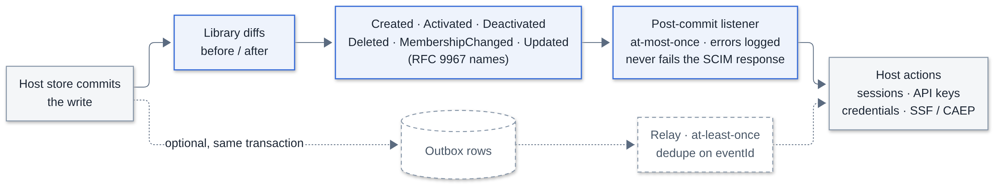
*Figure 14. Event delivery: post-commit listener by default, transactional outbox when delivery must be durable*

1. **After commit only.** Events never fire for a rolled-back or failed write ([AWS transactional outbox](https://docs.aws.amazon.com/prescriptive-guidance/latest/cloud-design-patterns/transactional-outbox.md)).
2. **The post-commit hook cannot fail the request.** `ScimLifecycleListener.onCommitted` runs on a host-supplied coroutine scope. Exceptions and timeouts are caught and logged. They never change the SCIM response and never roll back the write. The client's change has already been applied, and failing it would only make Entra retry a change that already happened.
3. **Post-commit is at-most-once, and the docs say so.** A crash between commit and callback loses the event. Hosts that need durable delivery use the **in-transaction path**: the store receives `PendingEvents` in `create`/`replace`/`delete`/`patchGroup`, stamps them with the id, new version and revision, and writes outbox rows in the same transaction. A relay then publishes them at-least-once. That gives at-least-once delivery, and consumers make processing effectively exactly-once by deduping on `eventId` ([OneUptime outbox guide](https://oneuptime.com/blog/post/2026-07-22-transactional-outbox-duplicate-events/markdown); [Hookdeck](https://hookdeck.com/webhooks/guides/webhook-delivery-guarantees.md)).
4. **Ordering is per resource, by `revision`.** `version` is opaque, may be a hash or UUID, and cannot be sorted. A consumer that sees revision 12 after 14 for the same resource drops it as stale. There is no global ordering guarantee.
5. **Security-sensitive consumers use the outbox.** The post-commit listener is fine for caches, notifications and analytics. Anything that removes access, such as session revocation, the SSF transmitter or the credential-lifecycle module, should consume the transactional outbox, because it must not lose an event.

### 10.3 What the host does with it

The library knows nothing about sessions, API keys or credentials. The host does, for example: on `Deactivated`, end sessions and disable API keys; on `Deleted`, purge; later, feed the credential-lifecycle module (§11). If the host wants to tell other parties, the standards are now Final: OpenID SSF 1.0, CAEP 1.0 and RISC 1.0 were approved on 2 Sep 2025 ([SSF 1.0](https://openid.net/specs/openid-sharedsignals-framework-1_0.html); [CAEP 1.0](https://openid.net/specs/openid-caep-1_0.html); [RISC 1.0](https://openid.net/specs/openid-risc-1_0-final.html)). A host-level transmitter can turn `Deactivated` into RISC `account-disabled` and/or CAEP `session-revoked`, and `Deleted` into RISC `account-purged`. SSF complex subjects include a `tenant` member, which is why events carry tenant and connection. That transmitter is a host or Enterprise Stack concern, not part of the SCIM library.

### 10.4 Deactivation is an access-control change

A deactivated account in the store is not the same as denied access. Entra sends `active=false`, the adapter updates the row, and an existing session, refresh token or authorization cache keeps working. The post-commit listener cannot close that gap on its own: it runs after the response, may fail, and is at-most-once (§10.2).

Each host states four guarantees explicitly:

| Guarantee | Requirement |
|---|---|
| **New access** | Blocked from the committed account state. The host's sign-in path reads `active` from the store the SCIM write commits to, so this holds the moment the library returns success |
| **Existing access** | The host declares, per access type (sessions, refresh tokens, API keys), whether revocation is *synchronous* or *eventual within N minutes*. "Undefined" is not an acceptable answer |
| **Honest responses** | The SCIM response never implies a stronger guarantee than the host declared. A 200 means the account state is committed and new access is blocked. It says nothing more about existing sessions than the declared policy |
| **Recovery** | Incomplete revocation is finished by the host on its own. It must not depend on Entra or Okta retrying the request |

How the host meets the existing-access guarantee depends on where sessions live:

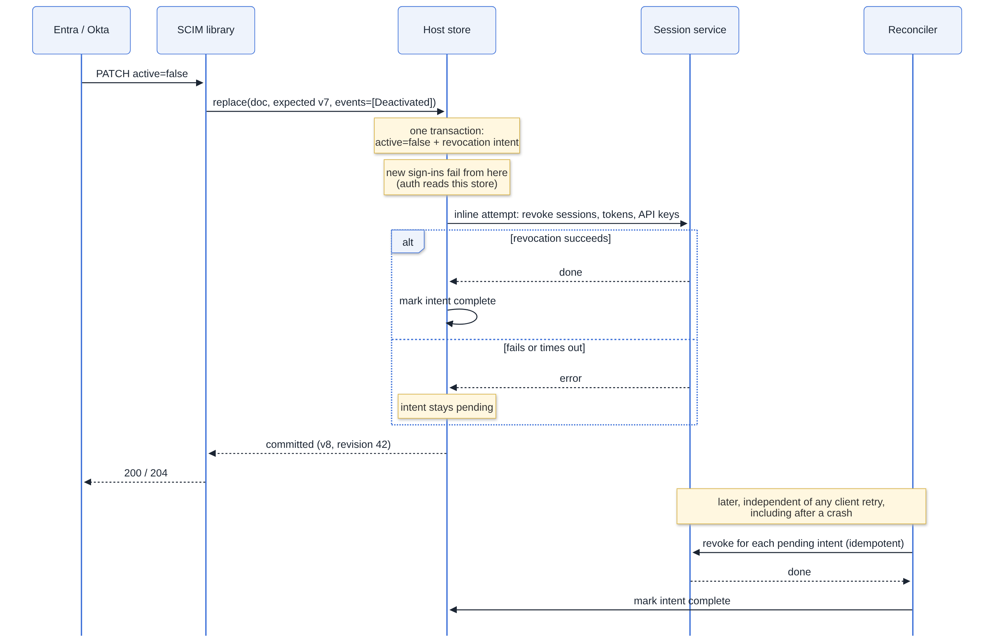
*Figure 15. Deactivation with a durable revocation intent: commit state and intent together, revoke, and let a reconciler finish anything left over*

- **Same transactional authority.** If sessions and tokens live in the same database as accounts, the store revokes them in the same transaction that sets `active=false`. That is a real synchronous guarantee.
- **Separate systems (the usual case).** The store commits `active=false` and a *revocation intent* row in one transaction, through the same outbox mechanism as §10.2. It then tries the revocation inline and marks the intent done. If revocation fails or the process crashes, the intent stays pending and a reconciler retries it until it succeeds. The response is 200 once the commit is done, because new access is already blocked. The declared existing-access guarantee is "eventual", bounded by the reconciler interval.
- **Revocation is idempotent and keyed by the intent.** Running it twice is harmless.
- **Reactivation never restores old sessions or tokens.** A reactivation that arrives while an intent is still pending does not cancel it: the old sessions still get revoked, and the user signs in again.

v2.1 had revoked first and committed second, relying on the client's retry to finish the job after a failure. The reviewer was right that this is fragile. A connection can be deleted, or a client can stop retrying, before the retry ever comes. The durable intent removes that dependency, so recovery is the host's responsibility and no longer the client's.

This keeps Jake's point 7 intact. The library still knows nothing about sessions, and the post-commit listener still cannot fail a request. Revocation belongs to the host's store and its reconciler, and the library supplies the pending events that make the intent row easy to write.

---

## 11. Credential lifecycle binding

v1 called this "DID/VC binding". Jake's three points change it enough to need a new name. The question is no longer "which DID does this account map to?" It is "when the directory says this account changed, which issued credentials must change status?"

### 11.1 x509-first (Jake's point B1)

The regulated, high-assurance ecosystems are X.509-anchored, and the specs walt.id customers are implementing say so directly:

- **eIDAS 2.0 / EUDI ARF.** PID providers, attestation providers, wallet providers and relying parties are authenticated with X.509 certificates that chain to Member State Trusted Lists or Lists of Trusted Entities (ETSI TS 119 612 / 119 602). ARF 3.0 (July 2026) requires trust anchors to come from those lists ([Biometric Update](https://www.biometricupdate.com/202607/conformance-framework-for-eu-digital-identity-wallets-arrives-with-arf-v3-0)). CIR 2024/2979 does not mention DIDs, judging from the secondary summary I could check ([iGrant.io](https://docs.igrant.io/regulations/implementing-acts-integrity-and-core-functions/)). Wallets are due around 24 Dec 2026 ([Start with Identity](https://startwithidentity.com/blog/eudi-wallet-december-2026-deadline.md)).
- **ISO mdoc.** A self-signed IACA root signs Document Signer certificates, the DS key signs the MSO, and VICALs distribute IACAs ([walt.id: ISO trust](https://docs.walt.id/concepts/trust-systems/iso-trust-vicals); [AAMVA DTS](https://aamva.org/identity/mobile-driver-license-digital-trust-service)).
- **SD-JWT VC.** It defines two issuer key resolution methods: issuer metadata over HTTPS, and `x5c`. DID resolution is not one of them ([draft-ietf-oauth-sd-jwt-vc-15 §3.5](https://www.ietf.org/archive/id/draft-ietf-oauth-sd-jwt-vc-15.html)). The draft is at -22 in IESG evaluation and has no RFC number yet ([datatracker](https://datatracker.ietf.org/doc/draft-ietf-oauth-sd-jwt-vc/)).
- **HAIP 1.0** (Final, December 2025). It makes `x5c` mandatory for SD-JWT VC issuers, requires Status List Tokens to carry their key in `x5c`, and does not mention DIDs ([HAIP 1.0 Final](https://openid.net/specs/openid4vc-high-assurance-interoperability-profile-1_0-final.html)).

The evidence supports "regulated ecosystems standardised on X.509". It does not quantify any decline in DID use, and DIDs remain in EBSI-style tracks. So the module's issuer configuration holds certificate chains and trust anchors. walt.id already has the X.509 service profiles for IACA, DS and ETSI providers ([walt.id X.509 service](https://docs.walt.id/enterprise-stack/services/x509-service/issue-certificates.md)). DID-based issuers are an optional later extension.

### 11.2 Bind to issued credential instances, not holder keys (Jake's point B2)

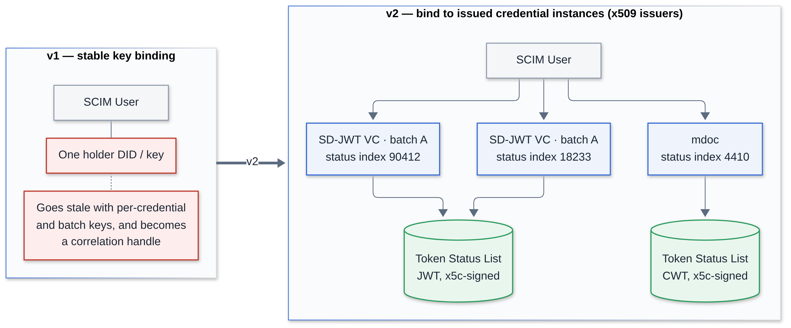
*Figure 16. From one stable holder key to per-credential status entries*

OpenID4VCI 1.0 (Final, September 2025) issues batches from the credential endpoint and recommends a different key for each credential in a batch, for unlinkability ([OpenID4VCI 1.0](https://openid.net/specs/openid-4-verifiable-credential-issuance-1_0.html)). The ARF requires wallets to support once-only and limited-time attestations. It requires values to be unique across attestations, status indices included, and it asks providers to discard unique values after issuance ([ARF Topic A](https://eudi.dev/latest/discussion-topics/a-privacy-risks-and-mitigations/)). The German PID flow binds each PID to its own device key ([BMI PID issuance](https://bmi.usercontent.opencode.de/eudi-wallet/wallet-development-documentation-public/latest/architecture-concept/03-data-flows/21-pid-issuance.html)).

A stable account → holder key or account → DID binding is therefore wrong in two ways. Under once-only refill it goes stale every batch. And if it were stable, it would be exactly the correlation handle these specs work to remove. So the module binds the account to **issued credential instances**:

```kotlin
data class IssuedCredentialRecord(
    val tenantId: String, val accountId: String,       // SCIM User id
    val instanceId: String,                            // issuer-internal
    val format: CredentialFormat,                      // dc+sd-jwt | mso_mdoc | w3c (later)
    val type: String,                                  // vct or doctype
    val status: StatusRef?,                            // list URI + index (+ purpose for Bitstring)
    val expiresAt: Instant,
    val batchId: String?,                              // instances issued together
    val sourceVersion: String,                         // SCIM resource version the claims came from
)
```

It stores no holder public key, no `cnf` thumbprint and no holder DID. Revocation does not need them, and ARF Topic A argues against keeping them. If a stable holder identity is genuinely needed, the ARF route is the wallet unit attestation and its status, not a key on the credential.

### 11.3 Status is per credential; claim changes mean revoke and reissue (Jake's point B3)

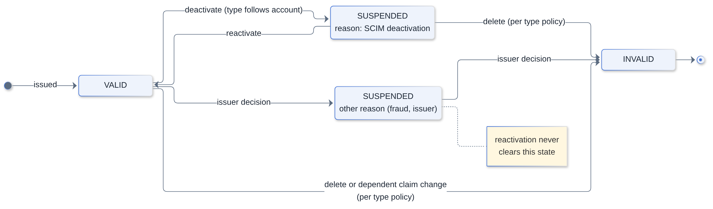
*Figure 17. Default credential status transitions under the issuer policy: reactivation clears only suspensions the SCIM deactivation caused (author proposal, not from a spec)*

Jake is right, and v2 drops partial revocation. The IETF Token Status List represents exactly one status per referenced token, with 0x00 VALID, 0x01 INVALID and 0x02 SUSPENDED in 2-bit lists ([draft-ietf-oauth-status-list-21](https://www.ietf.org/archive/id/draft-ietf-oauth-status-list-21.txt)). As of 3 November 2026 it is IESG-approved and in the RFC Editor queue (first edit), still an Internet-Draft with no RFC number. W3C Bitstring Status List v1.0 (Recommendation, May 2025) applies status to the whole credential through `revocation` (irreversible) and `suspension` (reversible) purposes ([W3C](https://www.w3.org/TR/vc-status-list/)). mdoc revocation in the 18013-5 second edition profiles Token Status List, but that edition was still at DIS stage in the ISO catalogue ([ISO 91081](https://www.iso.org/fr/standard/91081.html); [MATTR](https://learn.mattr.global/docs/issuance/token-status-list-feature-support)).

**The mapping is an issuer policy, not a fixed table.** The SCIM library reports what happened to the account. Whether a credential changes status is the issuer's decision, made by a `CredentialLifecyclePolicy` that sees the SCIM event, the credential type, the issuing authority, the credential's current status and the *reason* for that status. Neither status-list standard carries a reason, so the issuance registry stores one per credential (for example `SCIM_DEACTIVATION`, `FRAUD`, `ISSUER_DECISION`).

The defaults below are the author's proposal, not something any spec defines. Every row can be overridden per credential type.

| SCIM lifecycle event | Default policy | Token Status List (2-bit) | Bitstring Status List | Why |
|---|---|---|---|---|
| `Deactivated` | Suspend live credentials of types marked `followsAccountStatus`, recording reason `SCIM_DEACTIVATION` | VALID → SUSPENDED (0x02) | Set the `suspension` bit | Deactivation is reversible in SCIM, so the credential action must be too. Types that stay valid independently of the account, such as a qualification, are not marked and are left alone |
| `Activated` | Clear **only** suspensions whose recorded reason is `SCIM_DEACTIVATION` | SUSPENDED → VALID (0x00), only for those | Clear the `suspension` bit, only for those | A credential suspended for fraud or by an issuer decision must never come back just because an account was reactivated |
| `Deleted` | Per credential type: revoke (default for credentials that exist only because of the account), or leave alone where the issuer has obligations that outlive the account | → INVALID (0x01) where revoked | Set the `revocation` bit where revoked | Deleting an application account does not always end the issuer's obligations |
| `Updated` | Revoke and reissue only the credential types that declare a dependency on a changed attribute path | That type's instances → INVALID, then a fresh batch with new indices | `revocation`, then reissue | Needs an explicit, per-type claim-to-attribute dependency map. Without one, nothing is revoked automatically |
| `MembershipChanged` | Same as `Updated`, for credential types that declare a dependency on that group | Same | Same | Membership is just another claim |

The deactivate→suspend choice matters under eIDAS. CIR 2024/2977 treats revocation as irreversible and requires the user to be notified within 24 hours ([iGrant.io summary](https://docs.igrant.io/regulations/implementing-acts-pid-and-eaass/), secondary). Revoking on every SCIM `active=false` would make a routine directory toggle permanent. Bitstring needs two entries per credential (one for each purpose) if suspension is used. Token Status List does it with one 2-bit entry. Application-specific values such as 0x03 "superseded" are possible, but the status-list draft warns that extra states leak information, so the module sticks to the three standard values.

Two design consequences follow:

- **Split volatile attributes into separate credential types.** If department or role changes often, put them in their own credential type, so a change revokes only that type's instances and not the base employee credential.
- **Short-lived credentials are a real alternative.** The ARF exempts attestations valid for 24 hours or less from revocation, and HAIP recommends limiting validity with `exp`, status, or both ([go-statuslist on ARF VCR_01](https://pkg.go.dev/github.com/gmb-eudi/go-statuslist); [HAIP 1.0 Final](https://openid.net/specs/openid4vc-high-assurance-interoperability-profile-1_0-final.html)). With credentials of 24 hours or less, the module issues no status at all. `Deactivated`/`Deleted` invalidate the refresh token or issuance grant, and the account simply stops being refreshed, with at most one validity window of exposure. A deployment can mix the two approaches: short-lived credentials for routine access, status-listed ones for high-value long-lived credentials.

### 11.4 What exists and what is missing

`waltid-libraries/credentials/waltid-status-list` (Kotlin Multiplatform, `id.walt.credentials`) has `TokenStatusListCodec` (ZLIB, LSB-first, default 2^20 entries), `BitstringStatusListCodec` (GZIP, MSB-first, default 262,144 entries) and `StatusList2021Codec`. They are encode/decode only, modelled as `IndexedStatus(index, value)`. The module needs to add:

| Gap | Need |
|---|---|
| Index allocation | Random, non-sequential indices across large lists, with decoys and multiple lists for herd privacy. The status-list draft, Bitstring and ARF Topic A all call for this |
| Issuance registry | Persisting `IssuedCredentialRecord`, queried by account and type. Kept minimal, with no holder keys |
| Issuer lifecycle policy | The §11.3 policy, with a status reason per credential and a claim-to-attribute dependency map per type. Idempotent on `eventId`, ordered by `revision` |
| Status List Token signing with `x5c` | JWT `statuslist+jwt` for SD-JWT VC and CWT `statuslist+cwt` for mdoc, with the key in `x5c` as HAIP requires. The walt.id TSL docs I saw show JWT-only, `kid`+`did` signing, so this needs confirming with walt.id |
| Delegated status signer | Support for a separate status-signing certificate (`id-kp-oauthStatusSigning`, which walt.id Enterprise already models) |
| Fan-out | One SCIM event becomes N index writes (per batch member × credential type), batched into one list republish |

**Placement and phase.** This is a separate optional module (working name `waltid-scim-credential-lifecycle`, probably under `waltid-libraries/credentials/`, placement to be agreed). It ships in Phase 3, depends on `waltid-scim` (for event types only) and `waltid-status-list`, and consumes the lifecycle callback, ideally from the durable outbox. The core SCIM library stays identity-agnostic and never depends on it.

---

## 12. Protocol surface

| Method | Path | Notes |
|---|---|---|
| GET | `/ServiceProviderConfig` | From registry + config. Optionally unauthenticated |
| GET | `/ResourceTypes`, `/ResourceTypes/{name}` | Paging ignored, `filter` returns 403 |
| GET | `/Schemas`, `/Schemas/{urn}` | Paging ignored, `filter` returns 403 |
| POST | `/Users` | 201 + `Location`. 409 `uniqueness` on duplicate |
| GET | `/Users/{id}` | Deactivated users still returned. 404 after delete or outside the caller's domain. `If-None-Match` gives 304 |
| PUT | `/Users/{id}` | §4.3. 404 if absent |
| PATCH | `/Users/{id}` | §4.2. 200 + resource by default |
| DELETE | `/Users/{id}` | 204. Memberships removed in the same transaction. `If-Match` mismatch gives 412 |
| GET | `/Users?filter=&startIndex=&count=&attributes=&excludedAttributes=` | 1-based. No match gives 200 with `totalResults:0` |
| POST | `/Groups` | 201. Only registered if the store declares Groups (§7.5) |
| GET | `/Groups/{id}` | Honours `excludedAttributes=members` without touching the membership store. Members above `maxInlineMembers` give 400 `tooMany`, never a partial list (§4.7) |
| PUT | `/Groups/{id}` | Members via `ReplaceAll` diff when a membership store exists |
| PATCH | `/Groups/{id}` | §4.2/§4.4. 204 under the Entra profile, 200 otherwise (Okta requires 200) |
| DELETE | `/Groups/{id}` | 204. `If-Match` mismatch gives 412 |
| GET | `/Groups?filter=…` | As for Users |
| POST | `/{Users,Groups}/.search` | Same engine as GET search. Phase 1 if cheap, otherwise Phase 2 |
| any | `/Me`, `/Bulk` | 501. Out of scope; neither Entra nor Okta uses Bulk |

The optional `/v2` version segment is accepted; any other version returns 400 `invalidVers` ([RFC 7644 §3.13](https://www.rfc-editor.org/rfc/rfc7644#section-3.13)). Cursor pagination (RFC 9865) is deferred, as is any `/GroupMembers` resource. An individual Okta-authored draft proposes one, and its revision and adoption status are unconfirmed. The membership SPI (§6) is the layer either would sit on.

---

## 13. Conformance and interoperability test plan

| Layer | What | Where |
|---|---|---|
| Unit | Filter parser (ABNF, errata cases, precedence, quoting, `%20`), path resolver, every row of §4.2 and §4.3, `primary` exclusivity, implicit `schemas`, no-op detection, `returned`/projection | `waltid-scim` `commonTest` |
| Fixture replay | Every §9.2 rule in all three modes | `waltid-scim` `commonTest/resources/fixtures` |
| Engine contract | `ScimEngine` against an in-memory store: concurrency (forced `VersionConflict`, retry, exhaustion → 503, `If-Match` → 412), uniqueness → 409, membership-delta split and effective deltas, events fired only after commit, listener exceptions isolated | `waltid-scim` |
| Store contract kit | A reusable suite any adapter runs (§5.3): cross-connection isolation (get, search, filter, PUT, PATCH, DELETE and member references on another domain's ids all behave as missing), identity correlation (below), membership rules (§4.6), atomic rollback (a PATCH failing at op *n* leaves the stored version, data and event outbox untouched), conditional DELETE, parallel PATCHes on one user and one group with no lost updates, non-commuting membership cases (`ReplaceAll`, same-member add and remove, group delete) under concurrency, two tenants with the same connection id (no crossover), monotonic `revision`, consistent `readMembers` snapshots, declared capabilities matching behaviour | `waltid-scim` `testFixtures`, run against the in-memory store and every real adapter |
| Deactivation | Committed deactivation blocks new sign-in. The revocation intent commits with `active=false`. A failed or crashed revocation is completed by the reconciler with no client retry. Reactivation does not cancel a pending intent (§10.4) | Engine contract + Wallet2 adapter |
| Documents and modes | Path-less `add`/`replace` accepted in RFC mode and rejected only in the interop profile; each `UnknownAttributePolicy`; opaque data unreachable through typed views; conflicting case-insensitive duplicate keys rejected; `""` treated as a value outside the Entra profile | `waltid-scim` `commonTest` |
| Concurrency safety | Weak `If-Match` match and mismatch (412); a `SINGLE_WRITER_ONLY` store refuses to start without `singleWriter = true`; PUT retry documented as last-writer-wins | Engine contract + `waltid-scim-server` |
| HTTP | Status codes and wire rules from §7.6, discovery 403 on filter, 401 on a wrong connection, 403 on a missing permission, limits from §7.7 (413, 400 `invalidFilter`), routes absent for undeclared resource types | `waltid-scim-server` with ktor test host |
| Validator parity | Entra's 11 direct compliance tests and the Okta Runscope CRUD flow, reproduced in CI | `waltid-scim-server` |
| Live | Entra test tenant (default + `aadOptscim062020`), Entra SCIM Validator, Entra gallery Logic App validation, Okta dev org (OIN-style + AIW), Runscope suites | Phase 2, against the Wallet2 adapter |

**Identity correlation scenarios**, run before any live tenant: the same `userName` in two connections (per-connection and per-tenant domain models); a re-POST of an existing user (409, no second account); a pre-existing non-SCIM account with the same email (not linked); the same `externalId` from two directories; a connection replaced and the domain moved (no duplicates on the next full sync); and delete followed by re-create (new `id`, old `id` 404).

The minimum live scenario from v1 still applies: create, look up, update, deactivate, reactivate, create group, add member, remove member, replace, paginate, and the expected error cases. It now also covers null update, manager set/change/remove, Okta's all-caps `userName`, and parallel PATCHes against one group.

---

## 14. Phasing

Figure 3 in the executive summary shows the same plan at a glance.

Phase 1 keeps its full scope but lands as four PRs, each reviewable on its own. The reviewer's point stands: an in-memory store alone does not prove the abstraction, so the design counts as validated only when PR 5 passes on a real walt.id adapter.

| Increment | Scope | Owner | Accepted when |
|---|---|---|---|
| **PR 1 — User core** | `ScimDocument` with `UnknownAttributePolicy`, schema registry (User, Enterprise User), validation, filter parser and in-memory evaluator, store SPI with context, permissions, `ProvisioningScope` check and `revision`, PUT, the PATCH subset clients send for users (path-less replace, `active`, simple paths), `meta`, errors, index paging, capability profile and discovery builders, in-memory store, store contract kit | Saurabh | Create, read, filter (`userName eq`, `externalId eq`), PUT, deactivate, reactivate and delete pass against the in-memory store. Contract kit green for isolation, correlation and rollback |
| **PR 2 — Routes** | `waltid-scim-server`: Ktor routes for Users and discovery, context resolver, static-bearer and OAuth client-credentials authenticators, wire format (§7.6), limits (§7.7) | walt.id | Ktor test-host suite green for core HTTP and RFC behaviour (status codes, headers, wire format, auth, limits). Vendor validators wait for PR 4 |
| **PR 3 — Full PATCH and Groups** | Every §4.2 case, Groups, membership store and §4.6 rules, concurrency retry (§4.5), lifecycle events and the enforcement ordering (§10) | Saurabh (core), walt.id (Group routes) | Every §4.2, §4.6 and §4.7 row has a test. Rollback, parallel-PATCH, non-commuting membership, event-after-commit and revocation-intent tests green |
| **PR 4 — Vendor compatibility** | Compatibility layer (§9), lenient, RFC and interop-profile modes, fixture corpus | Saurabh | Every §9.2 rule replays in all three modes. The Entra SCIM Validator and Okta Runscope suites pass against the in-memory store |
| **PR 5 — Real host (Phase 2)** | Wallet2 API store adapter; live Entra (both PATCH modes) and Okta runs | Saurabh, with walt.id | Contract kit passes on the Wallet2 adapter, and the full lifecycle works on live tenants. Only now is the design called validated |
| **Enterprise Stack (Phase 2)** | Integration with the Enterprise Stack | walt.id | walt.id's acceptance |
| **Phase 3 — Credential lifecycle (optional)** | `waltid-scim-credential-lifecycle`: issuance registry, random index allocation, event → status mapper, x5c-signed Status List Tokens (JWT and CWT), short-lived credential mode. x509 first; DID issuers only if demand appears | Saurabh + walt.id | Scope agreed after Phase 2 |
| **Later, if needed** | RFC 9865 cursor paging, `/Bulk`, RFC 9967 SET emitter, `/GroupMembers`, RFC 9944 device schemas, nested groups | — | Demand-driven |

Phase 1 should be usable as a generic SCIM library with no walt.id-specific code. Phase 2 proves the abstraction against a real walt.id service.

---

## 15. Open questions for walt.id

1. **Sanitized vendor traffic.** Can Enterprise customers' Entra/Okta/other SCIM traffic be captured and sanitized into fixtures? Which clients beyond Entra and Okta do customers run (Ping, SailPoint, OneLogin, JumpCloud)?
2. **First host.** Is the Wallet2 API account model the right Phase 2 target, and what should a SCIM User map to: an account, a wallet, or both? What, if anything, should a Group map to?
3. **Page sizes.** Default 100 is proposed. Is a max of 1,000 acceptable for the Enterprise Stack's backing stores?
4. **Durable events.** Does the Enterprise Stack have an outbox or event bus that the in-transaction hook should target? Who owns the SSF/CAEP transmitter, if one is wanted?
5. **Status List signing.** Does the Enterprise Credential Status Service (or will it) sign Token Status Lists with `x5c`, and in CWT form for mdoc? The docs I saw show JWT-only with `kid`+`did`.
6. **Tenant, connection and domain model.** How does the Enterprise Stack identify tenants today, and is the per-connection path plus credential layout (§5.2) compatible with it? Should connections in one tenant see each other's accounts (per-tenant domain) or not (per-connection, the default) (§5.3)? Is there an admin flow for replacing a connection (§3.5)?
7. **Auth in the routes module.** Which authenticators should ship in `waltid-scim-server` first: static bearer, OAuth access-token introspection/JWT validation for Entra client credentials, or the RFC 7523 assertion for WIF?
8. **Licence policy for third-party fixtures** (§9.3): who signs off?
9. **Unverified points to settle on live tenants:** whether new Entra tenants default to compliant PATCH, the exact form of the `aadOptscim062020` URL flag, Okta reactivation and password-sync payloads, and the Content-Type on Okta writes.
10. **Session revocation.** What does a deactivation do to live sessions, refresh tokens and API keys in Wallet2 and the Enterprise Stack today? Do sessions live in the same database as accounts (synchronous revocation), or elsewhere (revocation intent plus reconciler) (§10.4)?
11. **Conditional writes.** Can the Wallet2 and Enterprise Stack account stores do atomic compare-and-set? If not, which serialisation mechanism should the adapter use (§4.5)?
12. **Credential policy.** For which credential types should status follow the account, and which have obligations that outlive it (§11.3)?

---

## References

**IETF / standards**
- RFC 7643, SCIM Core Schema — https://www.rfc-editor.org/rfc/rfc7643
- RFC 7644, SCIM Protocol — https://www.rfc-editor.org/rfc/rfc7644 ; errata — https://www.rfc-editor.org/errata/rfc7644 ; EID 6893 — https://rfc-editor.org/errata/eid6893
- RFC 9865, Cursor-Based Pagination of SCIM Resources — https://www.rfc-editor.org/rfc/rfc9865.html
- RFC 9967, SCIM Profile for Security Event Tokens (May 2026) — https://www.rfc-editor.org/rfc/rfc9967
- RFC 9110, HTTP Semantics, §13.1.1 If-Match — https://www.rfc-editor.org/rfc/rfc9110#section-13.1.1
- RFC 9944, Device Schema Extensions to SCIM — https://datatracker.ietf.org/doc/draft-ietf-scim-device-model/
- SCIM WG documents and charter — https://datatracker.ietf.org/wg/scim/documents/ ; https://datatracker.ietf.org/wg/scim/about/
- draft-zollner-scim-interop-profile-01 (individual, expired) — https://www.ietf.org/archive/id/draft-zollner-scim-interop-profile-01.html
- draft-zollner-scim-group-members-01 (individual) — https://bgpupdates.potaroo.net/ietf/ids/draft-zollner-scim-group-members-01.html
- RFC 9901, SD-JWT — https://rfc-editor.org/rfc/rfc9901.html
- draft-ietf-oauth-sd-jwt-vc — https://datatracker.ietf.org/doc/draft-ietf-oauth-sd-jwt-vc/ ; -15 — https://www.ietf.org/archive/id/draft-ietf-oauth-sd-jwt-vc-15.html
- draft-ietf-oauth-status-list-21 (Internet-Draft; IESG-approved, in the RFC Editor queue as of 3 Nov 2026) — https://datatracker.ietf.org/doc/draft-ietf-oauth-status-list/ ; https://www.ietf.org/archive/id/draft-ietf-oauth-status-list-21.txt
- W3C Bitstring Status List v1.0 — https://www.w3.org/TR/vc-status-list/
- OpenID4VCI 1.0 — https://openid.net/specs/openid-4-verifiable-credential-issuance-1_0.html
- OpenID4VC HAIP 1.0 Final (December 2025) — https://openid.net/specs/openid4vc-high-assurance-interoperability-profile-1_0-final.html
- OpenID SSF 1.0 — https://openid.net/specs/openid-sharedsignals-framework-1_0.html ; CAEP 1.0 — https://openid.net/specs/openid-caep-1_0.html ; RISC 1.0 — https://openid.net/specs/openid-risc-1_0-final.html
- ISO/IEC DIS 18013-5 Ed. 2 — https://www.iso.org/fr/standard/91081.html ; ISO/IEC TS 18013-7:2025 — https://www.iso.org/standard/91154.html
- W3C Trace Context Level 2 — https://w3.org/TR/trace-context-2

**eIDAS / EUDI**
- ARF Topic A, privacy risks and mitigations — https://eudi.dev/latest/discussion-topics/a-privacy-risks-and-mitigations/
- ARF 3.0 coverage — https://www.biometricupdate.com/202607/conformance-framework-for-eu-digital-identity-wallets-arrives-with-arf-v3-0
- CIR 2024/2977 summary — https://docs.igrant.io/regulations/implementing-acts-pid-and-eaass/ ; CIR 2024/2979 summary — https://docs.igrant.io/regulations/implementing-acts-integrity-and-core-functions/
- EC Digital Building Blocks — https://ec.europa.eu/digital-building-blocks/sites/x/jQB4Kg
- Wallet deadline — https://startwithidentity.com/blog/eudi-wallet-december-2026-deadline.md
- German EUDI architecture, PID issuance — https://bmi.usercontent.opencode.de/eudi-wallet/wallet-development-documentation-public/latest/architecture-concept/03-data-flows/21-pid-issuance.html
- go-statuslist (ARF Topic 7 notes) — https://pkg.go.dev/github.com/gmb-eudi/go-statuslist
- MATTR Token Status List support — https://learn.mattr.global/docs/issuance/token-status-list-feature-support ; mdoc revocation — https://learn.mattr.global/docs/mdocs/revocation
- AAMVA Digital Trust Service — https://aamva.org/identity/mobile-driver-license-digital-trust-service

**Vendor client behaviour**
- Entra: Use SCIM to provision users and groups — https://learn.microsoft.com/en-us/entra/identity/app-provisioning/use-scim-to-provision-users-and-groups
- Entra: SCIM compatibility / known issues — https://learn.microsoft.com/en-us/entra/identity/app-provisioning/application-provisioning-config-problem-scim-compatibility ; https://learn.microsoft.com/en-us/entra/identity/app-provisioning/known-issues
- Entra: How provisioning works — https://learn.microsoft.com/en-us/entra/identity/app-provisioning/how-provisioning-works
- Entra: App Gallery requirements and validation — https://learn.microsoft.com/en-us/entra/identity/enterprise-apps/app-gallery-user-provisioning-requirements ; https://learn.microsoft.com/en-us/entra/identity/enterprise-apps/validate-user-provisioning-app-gallery
- Entra validator test overview — https://github.com/AzureAD/SCIMReferenceCode/blob/master/Microsoft.SCIM.LogicAppValidationTemplate/StandardLogicApp/SCIM-Validation-Test-Overview.md
- Entra SCIM Validator tutorial — https://learn.microsoft.com/en-us/entra/identity/app-provisioning/scim-validator-tutorial
- Entra quarantine — https://learn.microsoft.com/en-us/entra/identity/app-provisioning/application-provisioning-quarantine-status
- Microsoft Q&A (unofficial): 2284725 — https://learn.microsoft.com/en-us/answers/questions/2284725/understanding-scim-client-request-behavior-and-exp ; 430827 — https://learn.microsoft.com/en-za/answers/questions/430827/adding-members-to-a-group-triggers-both-add-and-re
- Okta SCIM 2.0 reference — https://developer.okta.com/docs/api/openapi/okta-scim/guides/scim-20/
- Okta inbound SCIM — https://developer.okta.com/docs/api/openapi/okta-scim/inbound/overview
- Okta prepare / test / OIN submission — https://developer.okta.com/docs/guides/scim-provisioning-integration-prepare/main/ ; https://developer.okta.com/docs/guides/scim-provisioning-integration-test/main/ ; https://developer.okta.com/docs/guides/submit-app/scim/submission2-specific/
- Okta support: update methods — https://support.okta.com/help/s/article/differentiate-scim-update-methods-for-okta-app-integration-wizard-and-okta-integration-network-applications
- OneLogin SCIM — https://developers.onelogin.com/scim/implement-scim-api
- AWS IAM Identity Center SPC — https://docs.aws.amazon.com/singlesignon/latest/developerguide/serviceproviderconfig.html
- GitHub EMU SCIM — https://docs.github.com/en/enterprise-cloud@latest/rest/enterprise-admin/scim
- Auth0 inbound SCIM — https://auth0.com/docs/authenticate/protocols/scim/configure-inbound-scim.md
- WorkOS SCIM docs / debuggability — https://workos.com/docs/integrations/scim.md ; https://workos.com/blog/making-scim-debuggable
- Slack SCIM rate limits — https://docs.slack.dev/reference/scim-api/rate-limits

**Libraries**
- pingidentity/scim2 (UnboundID) — https://github.com/pingidentity/scim2 ; CHANGELOG — https://github.com/pingidentity/scim2/blob/master/CHANGELOG.md
- Captain-P-Goldfish/SCIM-SDK — https://github.com/Captain-P-Goldfish/SCIM-SDK
- python-scim scim2-server / scim2-models — https://github.com/python-scim/scim2-server ; https://github.com/python-scim/scim2-models
- apache/directory-scimple — https://github.com/apache/directory-scimple
- elimity-com/scim — https://github.com/elimity-com/scim
- i2-open/i2scim — https://github.com/i2-open/i2scim

**Event delivery**
- AWS transactional outbox — https://docs.aws.amazon.com/prescriptive-guidance/latest/cloud-design-patterns/transactional-outbox.md
- OneUptime outbox at-least-once — https://oneuptime.com/blog/post/2026-07-22-transactional-outbox-duplicate-events/markdown
- Hookdeck webhook delivery guarantees — https://hookdeck.com/webhooks/guides/webhook-delivery-guarantees.md

**walt.id**
- Credential Status Service — https://docs.walt.id/enterprise-stack/services/credential-status-service/overview.md
- X.509 service — https://docs.walt.id/enterprise-stack/services/x509-service/issue-certificates.md
- ISO trust (VICALs/IACAs) — https://docs.walt.id/concepts/trust-systems/iso-trust-vicals
- Local repo: `waltid-libraries/credentials/waltid-status-list`, `waltid-libraries/protocols/waltid-openid4vc-wallet-server`, `waltid-libraries/waltid-library-commons`
