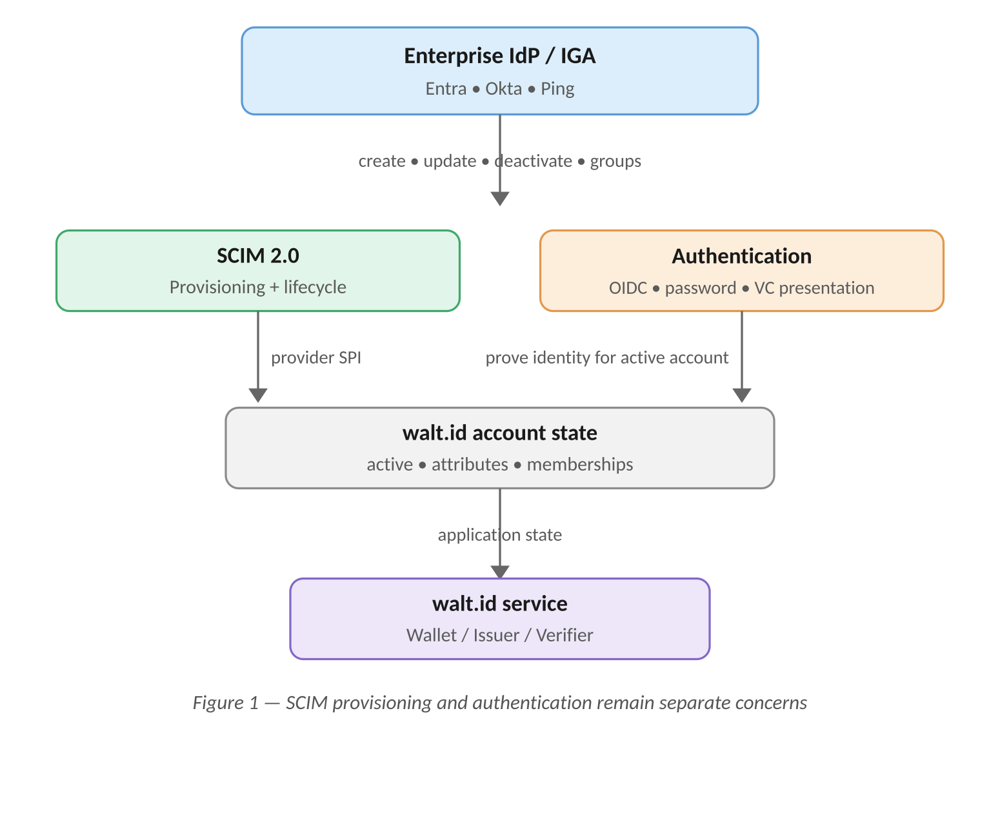
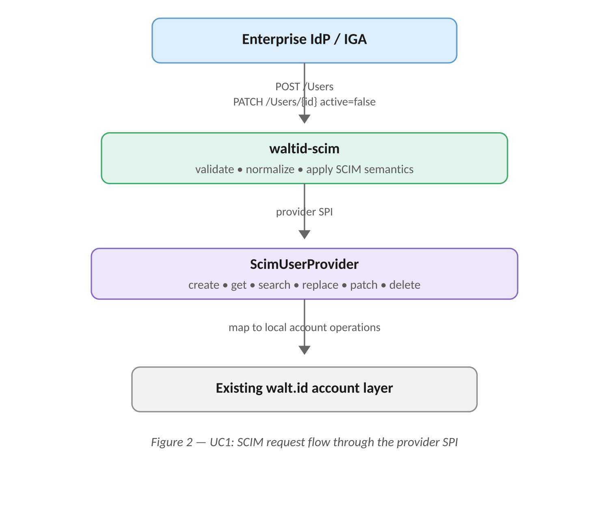
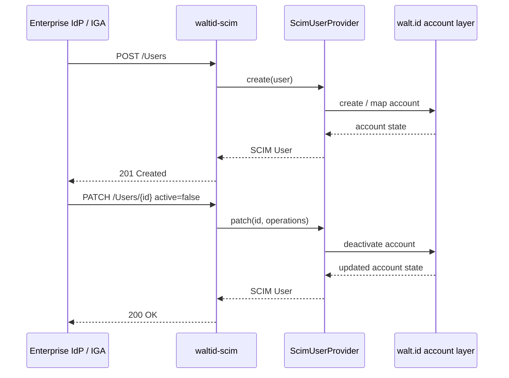
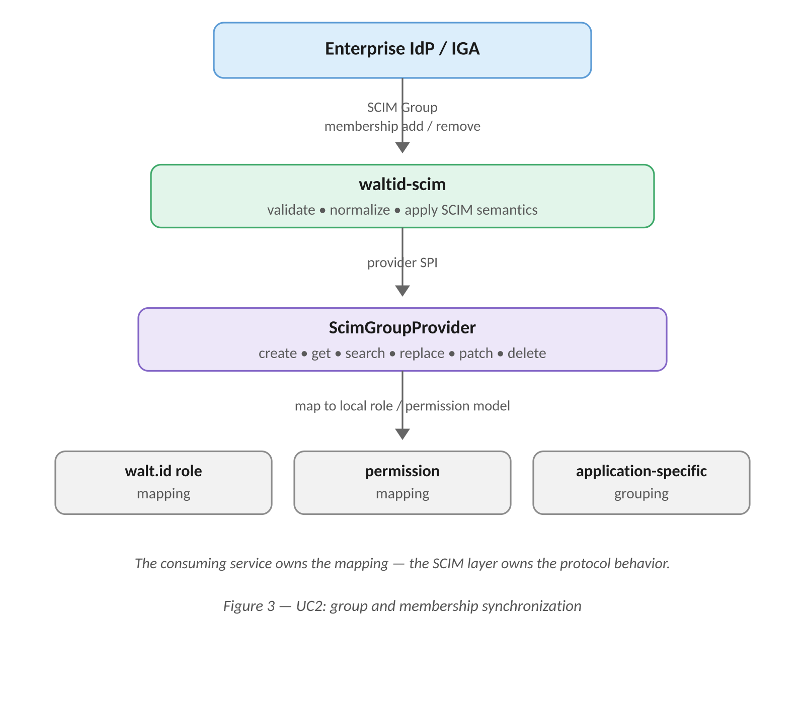
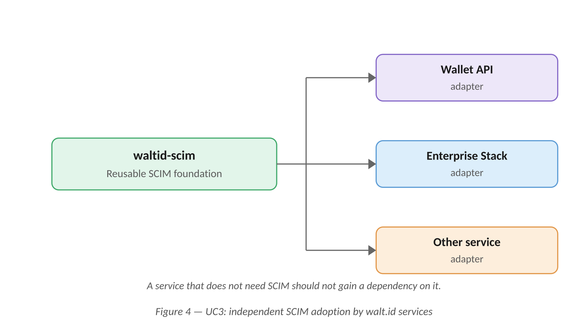
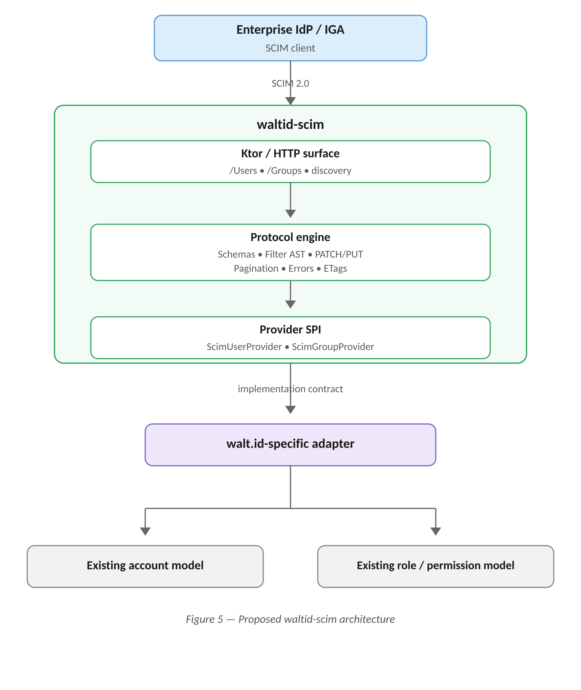

# A SCIM 2.0 Module for walt.id

**Use cases and architecture sketch — prepared for the alignment call**

> **Superseded.** This is v1, kept for history. The current design is [v2.2](waltid-scim-design-v2.md).

This document answers the two questions walt.id raised: what the library should cover, and how it should be shaped.

The proposal is intentionally narrow: add a clean SCIM 2.0 foundation that lets standards-compliant enterprise provisioning clients such as Microsoft Entra ID, Okta, Ping, or an IGA platform provision and deprovision walt.id resources. The same library should also be usable by implementors outside walt.id.

Phase 1 has no dependency on DIDs, credentials, wallet logic, or any other walt.id-specific identity feature.

Where the design goes beyond the RFC text, the goal is practical interoperability: implement the parts of SCIM that real enterprise provisioning clients depend on, without turning the first contribution into a broader identity-governance project.

---

## 0. Framing

SCIM and the OIDC Bridge solve different problems.

The OIDC Bridge is part of the authentication path. SCIM carries enterprise-managed account and group lifecycle into walt.id.

A simple way to think about the boundary is:

- **OIDC / VC presentation / other authentication methods:** how does an active account prove identity?
- **SCIM:** should the account exist, is it active, and which directory-managed attributes or group memberships should it have?

The initial SCIM module should not depend on the OIDC Bridge, and the Bridge should not need to understand SCIM protocol details.



---

## 1. Use Cases

### UC1 — Provision and deprovision accounts from an enterprise IdP

This is the main reason for the module.

An enterprise IdP or IGA platform acts as the SCIM client and calls a walt.id-hosted SCIM endpoint. The SCIM layer validates the request and delegates the actual account operation to the consuming service through a provider interface.



At the wire level, the same flow looks like this:



Two practical behaviors should shape the implementation from the start.

**Deactivation is different from deletion.** Enterprise provisioning systems commonly deactivate an account by setting `active` to `false`. A deactivated account should therefore remain addressable and capable of later reactivation. Hard deletion is a separate operation.

**Provider-specific request variations exist.** The implementation should emit standards-compliant SCIM and remain deliberately tolerant at well-understood interoperability boundaries. Those tolerances should be explicit and tested rather than hidden in request handlers.

### UC2 — Group and membership synchronization

Groups are a common way for enterprise directories to express application access and entitlements.

The SCIM module should support standard Group resources and incremental membership changes through PATCH. It should not decide what a group means inside a consuming application.



The consuming service owns the mapping. The SCIM layer owns the protocol behavior.

### UC3 — Allow walt.id services to adopt SCIM independently

The SCIM library should not assume that Wallet API, Issuer API, Verifier API, or every Enterprise deployment uses the same account model.

A service adopts SCIM by implementing the provider interfaces it needs.



A service that does not need SCIM should not gain a dependency on it.

### Future direction, not part of the initial proposal

The architecture should leave room for future SCIM resource types or lifecycle integrations without including them in Phase 1.

That means the initial design should avoid hard-coding assumptions that would make later extensions difficult, but no DID/VC lifecycle binding, Agent resource, custom tenant extension, or credential-status integration is required for the first implementation.

---

## 2. Data Model — Phase 1

Phase 1 uses the standard SCIM 2.0 resource model:

- `User`
- `Group`
- Enterprise User extension
- `PatchOp`
- `ListResponse`
- SCIM Error
- `ServiceProviderConfig`
- `ResourceType`
- `Schema`

The value of the core module is that it remains a SCIM implementation rather than a walt.id-specific schema.

A few implementation decisions should be explicit from the start.

### Filter grammar

Implement the RFC 7644 filter grammar as a real parser.

This includes logical operators, comparison operators, presence checks, and `valuePath` expressions such as:

```text
emails[type eq "work"]
```

The parser should produce an internal filter representation that a provider can translate into its own query mechanism.

A regular-expression-based filter implementation will become difficult to maintain once nested and multi-valued attributes are involved.

Filtering capability is advertised through `/ServiceProviderConfig`. Invalid or unsupported expressions should return the appropriate SCIM error response.

### Pagination

Phase 1 supports standard RFC 7644 index pagination:

```text
startIndex
count
totalResults
itemsPerPage
```

The provider API should avoid assumptions that prevent other pagination strategies later, but cursor pagination is not part of the first implementation.

### Resource versioning

`meta.version` and ETag support should be available when the backing provider can supply reliable resource versions.

The SCIM layer can honor conditional updates such as `If-Match` when versioning is enabled, but the provider SPI should not require every backend to implement versioning.

### Attribute mutability

Schema metadata should enforce SCIM mutability rules such as:

```text
readOnly
readWrite
immutable
writeOnly
```

Mutability should be enforced centrally rather than duplicated across route handlers.

---

## 3. Architecture

### 3.1 Repository shape

For the first contribution, keep the packaging simple.

```text
waltid-libraries/
  protocols/
    waltid-scim/
```

The exact internal package layout can evolve, but conceptually the module contains:

```text
model/
schema/
filter/
patch/
server/
spi/
```

If the codebase later justifies separate artifacts, the module can be split into core, Ktor server, and walt.id adapter modules without changing the protocol model.

A JVM-first implementation is reasonable for Phase 1 because the immediate consumers are server-side services. Kotlin Multiplatform can be reconsidered later if a real client-side use case appears.

### 3.2 Provider SPI

The SCIM library should define the operations it needs from a backing implementation.

For example:

```kotlin
interface ScimUserProvider {
    suspend fun create(user: ScimUser): ScimUser

    suspend fun get(id: String): ScimUser?

    suspend fun search(query: ScimSearchQuery): ScimPage<ScimUser>

    suspend fun replace(
        id: String,
        user: ScimUser,
        expectedVersion: String? = null
    ): ScimUser

    suspend fun patch(
        id: String,
        operations: List<ScimPatchOperation>,
        expectedVersion: String? = null
    ): ScimUser

    suspend fun delete(id: String)
}
```

Groups follow the same pattern:

```kotlin
interface ScimGroupProvider {
    suspend fun create(group: ScimGroup): ScimGroup

    suspend fun get(id: String): ScimGroup?

    suspend fun search(query: ScimSearchQuery): ScimPage<ScimGroup>

    suspend fun replace(
        id: String,
        group: ScimGroup,
        expectedVersion: String? = null
    ): ScimGroup

    suspend fun patch(
        id: String,
        operations: List<ScimPatchOperation>,
        expectedVersion: String? = null
    ): ScimGroup

    suspend fun delete(id: String)
}
```

The exact Kotlin signatures are illustrative. The important point is the dependency direction — a SCIM request flows down through the protocol layer into a provider contract, and only a walt.id-specific adapter at the bottom touches an existing account or permission implementation. The SCIM module should not replace the existing walt.id account store; a walt.id adapter translates the SCIM provider contract into the APIs already used by the target service.



### 3.3 Provisioning identity and correlation

SCIM provisioning metadata should not be modeled as a new authentication method.

A user may be provisioned by SCIM and authenticate through OIDC, password, passkey, or VC presentation. Those are separate concerns.

Where the consuming service needs to retain provisioning provenance, it can maintain metadata such as:

```kotlin
data class ProvisioningReference(
    val source: String,
    val connectionId: String?,
    val externalId: String?
)
```

`externalId` remains the provisioning client's correlation identifier. It should not be treated as an authentication credential.

### 3.4 Relationship to the OIDC Bridge

The two components can coexist without a direct protocol dependency.

| | OIDC Bridge | SCIM module |
|---|---|---|
| Primary concern | Authentication | Provisioning and lifecycle |
| Trigger | Login / presentation | Directory lifecycle operation |
| Source | Authentication flow | Enterprise IdP / IGA |
| Shared dependency | Account state, if the host application chooses | Account state, through provider SPI |

A SCIM deactivation may eventually cause an application to terminate sessions, but session-management behavior belongs to the host application or Enterprise Stack, not to the SCIM protocol module.

### 3.5 Client authentication and errors

The SCIM module should leave client authentication pluggable.

A reference server can support bearer-token authentication, while deployments remain free to use their own OAuth or gateway model.

Error handling should follow RFC 7644 and include both HTTP status and the SCIM error body where applicable.

Examples include:

```text
invalidFilter
invalidPath
invalidValue
mutability
uniqueness
tooMany
```

Correct SCIM error behavior matters for interoperability because provisioning clients use those responses when deciding whether to retry, quarantine, or report an operation as failed.

---

## 4. Protocol Surface — Phase 1

| Method | Path | Notes |
|---|---|---|
| GET | `/ServiceProviderConfig` | Advertises supported SCIM capabilities |
| GET | `/ResourceTypes` | Resource discovery |
| GET | `/Schemas` | Schema discovery |
| POST | `/Users` | Create User |
| GET | `/Users/{id}` | Read User |
| PUT | `/Users/{id}` | Replace User |
| PATCH | `/Users/{id}` | Partial update / deactivate / reactivate |
| DELETE | `/Users/{id}` | Delete User |
| GET | `/Users?filter=...&startIndex=...&count=...` | Search/list Users |
| POST | `/Groups` | Create Group |
| GET | `/Groups/{id}` | Read Group |
| PUT | `/Groups/{id}` | Replace Group |
| PATCH | `/Groups/{id}` | Incremental membership changes |
| DELETE | `/Groups/{id}` | Delete Group |
| GET | `/Groups?filter=...&startIndex=...&count=...` | Search/list Groups |

The initial proposal intentionally leaves out `/Me` and `/Bulk`.

`/Me` is not required for the enterprise provisioning use case.

`/Bulk` can be considered later after the basic User/Group interoperability surface is stable.

---

## 5. Conformance and Interoperability

Protocol tests should concentrate on the places where SCIM implementations most often diverge:

- filter parsing, including `valuePath`
- PATCH path resolution
- multi-valued attributes
- add / remove / replace semantics
- deactivate versus delete
- reactivation
- PUT replacement semantics
- attribute mutability
- uniqueness errors
- standard pagination
- resource version / ETag behavior when enabled
- Group membership changes
- correct `scimType` error responses
- documented provider-specific input tolerances

The module should be validated against real enterprise provisioning clients, not only unit tests.

For the initial release, Microsoft Entra ID and Okta are sensible interoperability targets.

A successful test should cover at least:

```text
create user
lookup user
update user
deactivate user
reactivate user
create group
add member
remove member
replace resource
list/search with pagination
expected error cases
```

---

## 6. Phasing

| Phase | Deliverables |
|---|---|
| **1 — SCIM foundation** | Standard User/Group models, Enterprise User extension, filter parser, PATCH/PUT behavior, index pagination, discovery endpoints, SCIM errors, provider SPI, reference Ktor routes |
| **2 — walt.id integration** | One concrete adapter to an existing walt.id account/permission model, plus Entra and Okta interoperability validation |
| **Later, only if needed** | Additional resource types, lifecycle integrations, Bulk, alternative pagination strategies, or other SCIM extensions |

Phase 1 should be useful as a generic SCIM library even without walt.id-specific code.

Phase 2 proves that the abstraction works against a real walt.id service.

Everything beyond that is demand-driven rather than bundled into the initial proposal.
